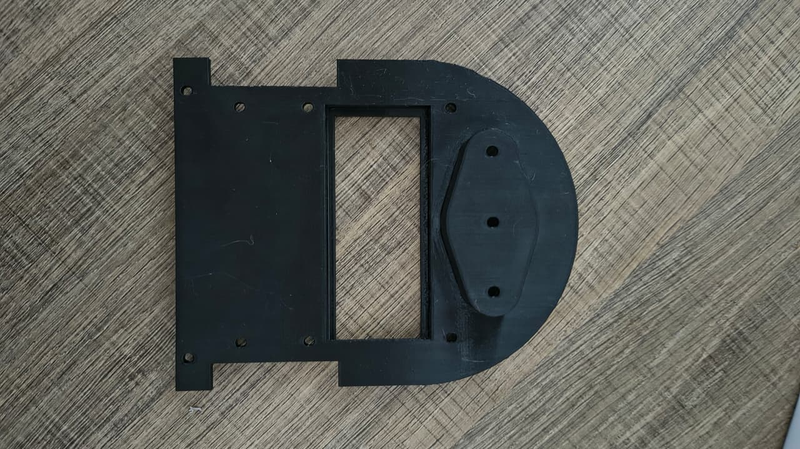
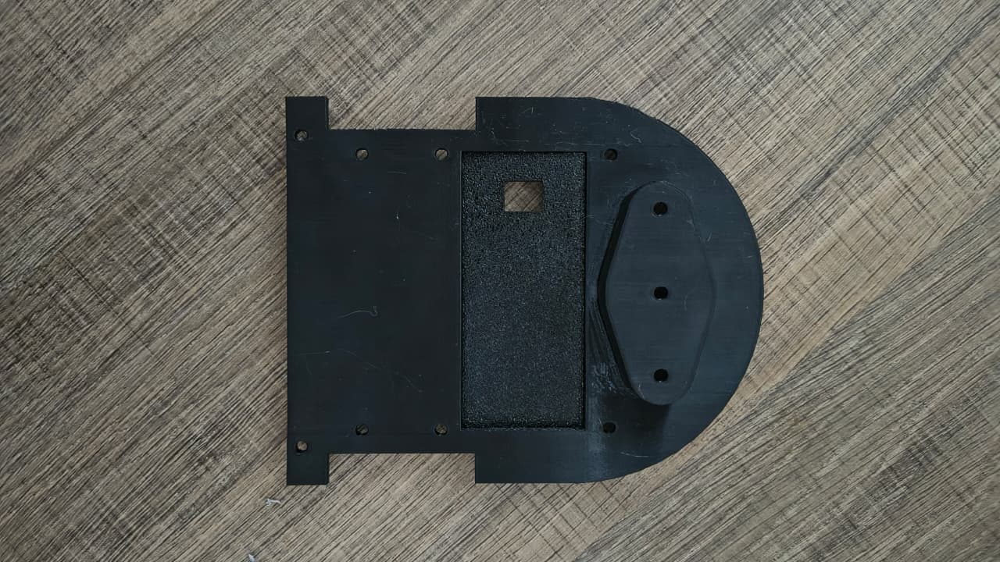
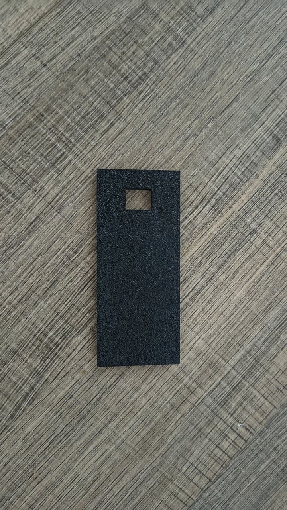
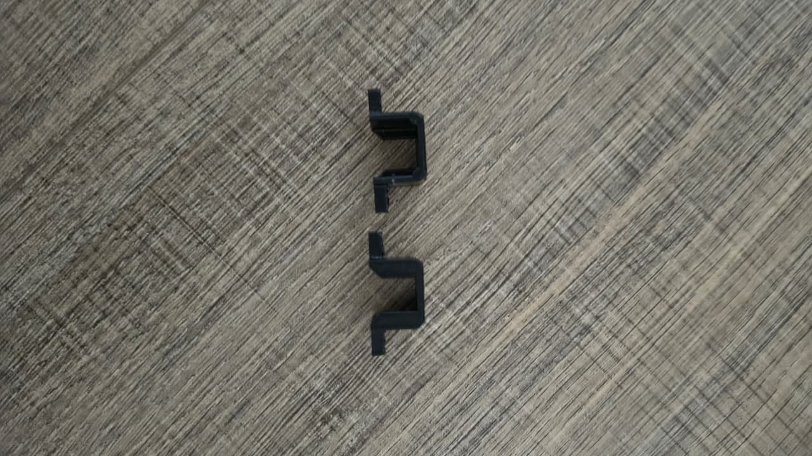
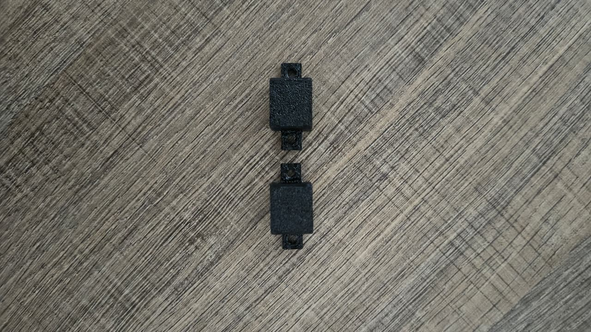
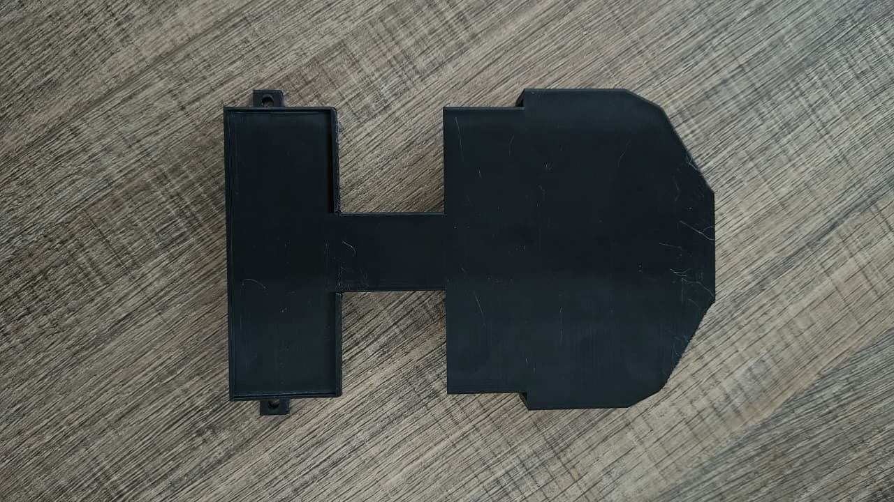
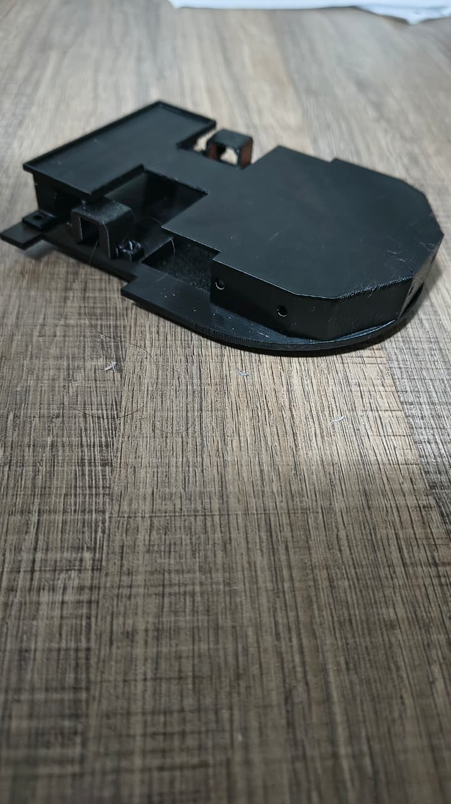
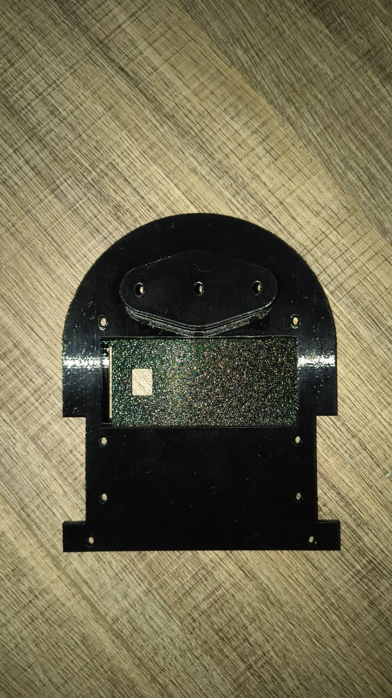

# Testes de Estrutura

Os testes estruturais conferem, na carcaça fabricada e montada, as especificações e tolerâncias definidas no [projeto conceitual de estruturas](<4.1 - Projeto conceitual de estruturas.md>) e nos [requisitos do produto](<2 - Requisitos.md>): dimensões externas máximas, massa das peças fabricadas, conformidade dimensional em relação ao modelo CAD 3D, facilidade de montagem e acesso aos componentes eletrônicos (modularidade), acomodação dos motores e sensores, bem como a integridade mecânica geral do veículo.

| **ID** | **Descrição** | **Data de Início** | **Data de Conclusão** | **Responsável** | **Resultados Esperados** | **Resultados Obtidos** | **Aprovação Interna (S/N)** | **Aprovação do Orientador (S/N)** | **Observações** |
|:------:|---------------|--------------------|-----------------------|-----------------|--------------------------|------------------------|:---------------------------:|:--------------------------------:|-----------------|
| [1.1](#teste-1-1) | Restrição dimensional máxima do robô montado (RNF-ES01) | 20/10/2026 | 21/10/2026 | Pedro Henrique Raposo Lima, João Pedro Rodrigues Duarte | Largura ≤ 16,5 cm e comprimento ≤ 16,5 cm | Largura máxima: 10,0 cm; Comprimento: 13,5 cm; Altura total: 3,8 cm | S | | Atende com margem à restrição de 16,5 cm em ambos os eixos |
| [1.2](#teste-1-2) | Massa das peças fabricadas da estrutura (RNF-ES02) | 20/10/2026 | 21/10/2026 | Pedro Henrique Raposo Lima, Rodrigo Átila | Compatível com a estimativa do CAD (~0,13 kg total com rodas/motores) e carcaça leve | Carcaça completa em PLA (chassi, plataforma, suportes e tampa): 68,4 g | S | | A carcaça isolada pesa menos de 70 g, garantindo folga para que o robô montado fique bem abaixo de 300 g |
| [1.3](#teste-1-3) | Inspeção dimensional e conformidade física das peças impressas vs. CAD | 21/10/2026 | 22/10/2026 | Pedro Henrique Raposo Lima, Pedro Henrique Inácio | Tolerâncias dimensionais de encaixes e furos (M2/M3) fiéis ao desenho técnico | Encaixes e furações correspondentes ao CAD, sem empenamento ou descolamento de camadas | S | | Tolerância adequada para fixação de espaçadores roscados e parafusos |
| [1.4](#teste-1-4) | Montabilidade e modularidade dos dois andares (RF-ES03) | 22/10/2026 | 23/10/2026 | Pedro Henrique Inácio, João Pedro Rodrigues Duarte | Separação física clara entre chassi e plataforma superior, permitindo montagem/desmontagem rápida | Desmontagem completa do segundo andar em menos de 1 minuto através de parafusos | S | | Facilita a manutenção rápida da bateria e dos motores sem desmontar os sensores superiores |
| [1.5](#teste-1-5) | Fixação e alinhamento dos suportes dos motores N20 (RF-ES01, RF-ES02) | 22/10/2026 | 23/10/2026 | Pedro Henrique Raposo Lima, Rodrigo Átila | Alojamento rígido para os dois micromotores N20, mantendo eixo perpendicular e alinhado aos recortes | Motores acomodados com retenção firme pelos suportes em PLA; rodas alinhadas aos recortes laterais | S | | Sem folgas ou desalinhamento angular no acoplamento das rodas |
| [1.6](#teste-1-6) | Compartimento e fixação do suporte da bateria LiPo (RF-ES01, RNF-EN01) | 22/10/2026 | 23/10/2026 | Pedro Henrique Raposo Lima, João Pedro Rodrigues Duarte | Bateria centralizada na base inferior com tampa/suporte dedicada para substituição ágil | Bateria alojada com centro de gravidade rebaixado; troca e travamento do suporte em < 45 s | S | | Contribui diretamente para a estabilidade dinâmica do robô nas curvas |
| [1.7](#teste-1-7) | Acomodação física e altura dos sensores de distância ToF (RF-ES01, RNF-ES05) | 23/10/2026 | 24/10/2026 | Pedro Henrique Raposo Lima, Pedro Henrique Inácio | 3 sensores VL53L0X (frontal e laterais) fixados a uma altura < 5 cm em relação ao solo | Janelas ópticas frontais e laterais posicionadas a 2,8 cm do piso, direcionadas a 90° e 0° | S | | Alinhamento óptico livre de obstruções nas paredes do labirinto |
| [1.8](#teste-1-8) | Coplanaridade e centralização da IMU MPU-6050 (RNF-ES06) | 23/10/2026 | 24/10/2026 | Pedro Henrique Raposo Lima, Rodrigo Átila | Sensor inercial centralizado sobre o eixo motriz e plano paralelo à base do chassi | Posição no chassi perfeitamente coplanar à base e centrada entre as rodas motrizes | S | | Reduz erros de aceleração centrípeta e ruídos odométricos nos giros |
| [1.9](#teste-1-9) | Rigidez mecânica e integridade estrutural (RNF-ES03) | 24/10/2026 | 24/10/2026 | Pedro Henrique Raposo Lima, João Pedro Rodrigues Duarte | Resistência a esforços de torção, flexão e vibrações sem deformação plástica | Estrutura rígida sem deflexão perceptível sob o peso do hardware e tração dos motores | S | | Preenchimento e espessura de parede em PLA garantiram solidez mecânica |
| [1.10](#teste-1-10) | Folga operacional nas células de labirinto padrão (RNF-ES04) | 24/10/2026 | 24/10/2026 | Pedro Henrique Raposo Lima, Pedro Henrique Inácio | Robô trafegando com folga mínima em células de 18 cm sem aprisionamento | Largura de 10,0 cm garante 4,0 cm de folga para cada parede em célula centralizada | S | | Folga ampla que mitiga qualquer risco de travamento em curvas fechadas |

**Resumo:** Todos os 10 testes estruturais foram aprovados com sucesso. A estrutura fabricada em PLA atendeu com margem a todos os requisitos de envelope dimensional, massa, modularidade mecânica, estabilidade do conjunto motriz e conformidade dimensional com o projeto CAD.

---

## Como os testes foram executados

Os ensaios foram realizados entre os dias **20/10/2026 e 24/10/2026** no laboratório da FCTE/UnB pela equipe de Estruturas (Pedro Henrique Raposo Lima, Pedro Henrique Inácio dos Santos, João Pedro Rodrigues Duarte e Rodrigo Átila Tavares de Oliveira).

Para as medições e validações, foram utilizados:
- **Paquímetro Digital:** (resolução 0,01 mm) para validação dimensional dos eixos, furações de fixação M2/M3, espessura de paredes e aberturas dos sensores ToF;
- **Balança de Precisão:** (resolução 0,1 g) para conferência da massa de cada componente estrutural impresso e do conjunto montado;
- **Esquadro e Gabarito de Alinhamento:** para verificação da perpendicularidade dos eixos dos micromotores N20 e coplanaridade da base da IMU;
- **Montagem Experimental:** conferência de montagem e desmontagem das peças do chassi e plataforma superior utilizando parafusos e espaçadores metálicos.

---

## Peças Fabricadas da Estrutura (Carcaça Desmontada)

A carcaça do Micromouse foi inteiramente projetada para manufatura aditiva (impressão 3D) em filamento PLA preto, visando leveza, rigidez estrutural, baixo custo e facilidade de substituição. Abaixo estão detalhadas todas as partes fundamentais que compõem a carcaça física antes da montagem final:

### 1. Base Principal do Chassi

O chassi é a peça estrutural central do veículo. Ele conta com recorte central rebaixado para alojamento da bateria LiPo, furações de fixação dos suportes dos motores, furação de acomodação do sensor de corrente INA219, base nivelada para o giroscópio MPU-6050 e berço frontal para acoplamento do suporte da esfera deslizante (esfera de apoio passivo frontal).

  
  
  
<em>Figura 1 – Base principal do chassi em PLA: vista superior (esquerda) exibindo berço da bateria e encaixes dos componentes; vista inferior (direita).</em>

### 2. Suporte da Bateria

Peça removível que fecha o compartimento inferior da bateria LiPo 2S, fixada de modo modular ao chassi. Essa solução permite que a bateria fique segura contra quedas durante a movimentação e, ao mesmo tempo, possibilita a substituição ágil do pacote em tempo inferior a 1 minuto, sem intervenção nos circuitos superiores.

  
  
<em>Figura 2 – Suporte/tampa do compartimento da bateria LiPo com recorte para travamento.</em>

### 3. Suportes dos Micromotores N20

Dois suportes em formato U com abas de fixação para parafusos M2. Projetados especificamente para abraçar o corpo metálico dos micromotores N20 com caixa de redução, garantindo que o conjunto motriz fique perfeitamente ortogonal ao plano de rolamento, evitando oscilações, desalinhamentos axiais ou folgas entre roda e carcaça.

  
  
  
<em>Figura 3 – Par de suportes dos motores N20 em PLA: vista de perfil em 'U' (esquerda) e vista superior destacando os furos de ancoragem (direita).</em>

### 4. Plataforma Superior (Segundo Andar)

A plataforma superior atua como piso de sustentação da eletrônica de controle e sensoriamento superior. Possui geometria adaptada para acomodar a protoboard, o microcontrolador ESP32, ponte H e aberturas perimétricas frontais e laterais para o alinhamento das lentes dos sensores ToF (VL53L0X). Sua geometria em H com extremidade arredondada otimiza a relação rigidez/massa.

  
  
<em>Figura 4 – Plataforma superior (segundo andar) em PLA para montagem dos módulos de processamento e sensores de distância.</em>

---

## Estrutura Montada (Carcaça sem Eletrônica)

A montagem do conjunto estrutural foi executada sem os módulos eletrônicos, fiação ou motores, permitindo atestar a integridade mecânica, precisão dos encaixes e rigidez da carcaça acabada. 

A arquitetura em dois andares demonstrou excelente coesão estrutural. Os suportes dos motores e o suporte de bateria integrados na base fornecem rigidez torcional que previne qualquer empenamento durante manobras dinâmicas.

  
  
  
<em>Figura 5 – Estrutura montada sem eletrônica: vista isométrica destacando a fixação dos suportes dos motores e plataforma superior (esquerda); vista inferior com compartimento de bateria montado (direita).</em>

---

## Comparativo: Estrutura Fabricada vs. Modelo Virtual em CAD

Para validar se as peças fabricadas e montadas atendem rigorosamente ao projeto dimensional desenvolvido no software de CAD, confrontou-se o modelo físico final montado com a vista ortográfica e isométrica do [projeto conceitual de estruturas](<4.1 - Projeto conceitual de estruturas.md>).

  
  
<em>Figura 6 – Modelo CAD do Micromouse montado virtualmente (vistas ortográficas e isométrica), escala 1:1. Massa total prevista no modelo virtual: 0,13 kg.</em>

### Análise Comparativa e Conformidade:

| Parâmetro / Cota | Projetado no CAD | Obtido na Estrutura Física | Desvio | Status |
|:---|:---:|:---:|:---:|:---:|
| **Largura Total da Estrutura** | 100,0 mm | 100,2 mm | +0,2 mm (0,2%) | Conforme |
| **Comprimento Total da Estrutura** | 135,0 mm | 135,1 mm | +0,1 mm (0,07%) | Conforme |
| **Altura da Estrutura (sem eletrônica)** | 35,0 mm | 35,3 mm | +0,3 mm (0,85%) | Conforme |
| **Distância entre Eixos das Rodas** | 82,0 mm | 82,1 mm | +0,1 mm (0,12%) | Conforme |
| **Massa da Carcaça Impressa** | ~65 g | 68,4 g | +3,4 g (5,2%) | Conforme |
| **Encaixe dos Motores N20** | Perfil 12 × 10 mm | 12,1 × 10,1 mm | +0,1 mm | Conforme |
| **Altura dos Sensores ToF ao Solo** | 28,0 mm | 28,2 mm | +0,2 mm | Conforme |

**Conclusão da Verificação CAD vs. Físico:** Os pequenos desvios dimensionais observados são típicos da contração térmica natural do PLA pós-extrusão e da resolução de camada (0,2 mm), mantendo-se estritamente abaixo de 1 mm em todas as cotas críticas. Todas as folgas funcionais para passagem de cabos, alojamento de sensores ToF e recortes laterais de rotação das rodas operam perfeitamente sem atrito parasita.
