# Testes de Energia

Os testes conferem, no robô montado, as previsões do [projeto conceitual de energia](<4.2 - Projeto conceitual de energia.md>): o consumo parado e com os motores girando, o consumo de cada componente, a autonomia de um lançamento, a saída dos reguladores e as proteções da bateria.

| **ID** | **Descrição** | **Data de Início** | **Data de Conclusão** | **Responsável** | **Resultados Esperados** | **Resultados Obtidos** | **Aprovação Interna (S/N)** | **Aprovação do Orientador (S/N)** | **Observações** |
|:------:|---------------|--------------------|-----------------------|-----------------|--------------------------|------------------------|:---------------------------:|:--------------------------------:|-----------------|
| [2.1](#teste-2-1) | Tensão da bateria lida pelo INA219, comparada com o multímetro | 24/10/2026 | 24/10/2026 | Rian Alencar e Eduardo Waski | Diferença de até 0,05 V | Multímetro: 7,75 V, com a bateria desconectada do robô. INA219: 7,66 V em média, com o robô ligado e puxando 169 mA. Diferença de 0,09 V (1,2%) | S | | Diferença pequena, mas um pouco acima dos 0,05: sem carga a tensão da bateria fica mais alta, o que explica parte dela |
| [2.2](#teste-2-2) | Consumo de cada componente, ligando um de cada vez, e corrente com o robô parado | 24/10/2026 | 24/10/2026 | Rian Alencar e Eduardo Waski | Parado: ~162 mA a 7,4 V. No trilho de 3,3 V: 20 mA por VL53L0X e 5 mA no MPU6050 | Parado: 180 mA na etapa E6 (7,43 V) e de 171 a 175 mA nos outros ensaios. VL53L0X: 16,8, 17,9 e 17,5 mA. MPU6050: 9,3 mA. WiFi: 89 mA no trilho de 5 V | S | | Parado de 6% a 11% acima do previsto, coberto pela margem de 1,5 do dimensionamento da bateria. O WiFi é o maior consumo com o robô parado. Tabela completa abaixo |
| [2.3](#teste-2-3) | Corrente total com os dois motores em PWM 200, com as rodas no ar e no chão | 24/10/2026 | 24/10/2026 | Rian Alencar e Eduardo Waski | ~866 mA a 7,4 V com os motores em carga. Com as rodas no ar, menor | Rodas no ar: 234 mA. Rodas no chão: 321 mA. Parado: 174 mA. Só os motores: 60 mA no ar e 146 mA no chão | S | | Bem abaixo do previsto, que usou a corrente nominal de catálogo do N20 (350 mA por motor). Pico na partida: 515 mA |
| [2.4](#teste-2-4) | Tensão na saída de cada regulador, com o multímetro | 24/10/2026 | 24/10/2026 | Rian Alencar e Eduardo Waski | 6 V: 5,70 a 6,30 V. 5 V: 4,75 a 5,25 V. 3,3 V: 3,14 a 3,47 V | 6 V: 5,95 V. 5 V: 5,11 V. 3,3 V: 3,31 V | S | | Uma leitura por trilho |
| [2.5](#teste-2-5) | Partidas seguidas dos motores em PWM 255, para ver se a queda de tensão reinicia o ESP32 | 24/10/2026 | 24/10/2026 | Rian Alencar e Eduardo Waski | Nenhum reinício do ESP32 | 13 partidas em 51 s, sem reinício. Pico de 988 mA e menor tensão registrada de 7,33 V | S | | Também não houve reinício nas 13 partidas do 2.8 nem no resto dos ensaios |
| [2.6](#teste-2-6) | Lançamento completo (comando `perfil`): 5 min parado e 10 min com os motores em PWM 200, rodas no ar | 24/10/2026 | 24/10/2026 | Rian Alencar e Eduardo Waski | ~1,18 Wh (~160 mAh) por lançamento com os motores em carga, sem corte nem reinício | 52,5 mAh e 0,398 Wh em 15 min. Bateria de 7,61 V para 7,55 V. Sem corte, aviso de sobrecorrente ou reinício | S | | Com a corrente do 2.3 no chão, o lançamento ficaria em ~68 mAh, e 80% da bateria dariam 17 lançamentos. A apresentação tem 3, ou seja, uma folga boa |
| [2.7](#teste-2-7) | Corte por subtensão: com os motores em PWM 150, o limite de corte sobe por comando para 8,0 V, acima da tensão da bateria | 24/10/2026 | 24/10/2026 | Rian Alencar e Eduardo Waski | Estado crítico 2 s depois, motores param e não religam | Crítico 2 s depois do comando (20:11:48 → 20:11:50), com a bateria em 7,34 V. Motores de PWM 150 para 0, parados até o limite voltar a 6,6 V | S | | Corte subiu para 8V para efeitos de teste e os motores pararam |
| [2.8](#teste-2-8) | Partidas bruscas dos motores (PWM 255 e parar) com os limites padrão: alerta em 7,0 V e corte em 6,6 V | 24/10/2026 | 24/10/2026 | Rian Alencar e Eduardo Waski | Estado continua normal | 13 partidas, parte delas com 1 s de intervalo. Estado normal o tempo todo. Pico de 1042 mA e menor tensão registrada de 7,29 V | S | | As quedas ficaram longe dos limites: o teste mostra que as partidas não geram alerta falso |
| [2.9](#teste-2-9) | Aviso de sobrecorrente: com os motores em PWM 255 (233 mA), o limite do aviso baixa por comando para 100 mA e depois volta a 2000 mA | 24/10/2026 | 24/10/2026 | Rian Alencar e Eduardo Waski | Aviso de sobrecorrente ~500 ms depois | "Sobrecorrente: 253 mA" logo após o comando (20:19:31 → 20:19:32,25). O aviso apagou quando o limite voltou a 2000 mA e o estado da bateria seguiu normal | S | | Os comandos são registrados com resolução de 1 s, então o atraso ficou entre 0,25 e 1,25 s, compatível com os 500 ms |

**Resumo:** os 9 testes foram aprovados. No 2.1 a diferença foi de 0,09 V, um pouco acima dos 0,05 V, explicada em parte pelo fato de as leituras terem sido feitas em momentos diferentes, com a bateria sem carga no multímetro.

## Como os testes foram feitos

Quase tudo foi medido pelo INA219, que fica na entrada da bateria e mede a tensão e a corrente do robô inteiro. O multímetro (Luatek LWJ-115, resolução de 0,01 V) foi usado na bateria e na saída dos reguladores.

Os ensaios usaram um firmware de bancada, separado do firmware do robô ([`src/firmware/testes`](https://github.com/fcte-pi1/2026.2_PI1_Grupo2_Diogo/blob/b912a30/src/firmware/testes/README.md), onde também está o roteiro). Ele lê o INA219 a cada 10 ms, soma a carga (mAh) e a energia (Wh) e manda as amostras pelo WiFi, 10 por segundo, para um script no computador que grava tudo em CSV. O mesmo firmware liga os componentes um de cada vez para o teste 2.2, gira os motores por comando e muda os limites de corte e de sobrecorrente sem precisar descarregar a bateria. O monitor da bateria (estados normal, baixa e crítica, mais o aviso de sobrecorrente) é o mesmo do firmware do robô, em `power_logic.h`.

Os ensaios foram feitos em 24/10/2026, das 18:46 às 20:20, com o robô na bancada e as rodas no ar, exceto na segunda parte do 2.3. Pela leitura do INA219, a bateria (LiPo 2S 1500 mAh) foi de 7,66 V a 7,33 V ao longo dos ensaios. O firmware e o roteiro foram preparados por Eduardo Waski, e os ensaios foram executados por Rian Alencar.

Os dados de cada ensaio estão em [`src/firmware/testes/resultados`](../src/firmware/testes/resultados):

| Teste | Arquivo |
|:---:|---|
| 2.1 | `2.1-ensaio-20261024-184616.csv` |
| 2.2 | `2.2-ensaio-20261024-195433.csv` e `2.2-ensaio-20261024-195902.csv` |
| 2.3 | `2.3-rodas-no-ar-ensaio-20261024-200045.csv` e `2.3-chao-ensaio-20261024-200304.csv` |
| 2.5 | `2.5-ensaio-20261024-200515.csv` |
| 2.6 | `2.6-ensaio-20261024-191023.csv` |
| 2.7 | `2.7-ensaio-20261024-201139.csv` |
| 2.8 | `2.8-ensaio-20261024-201351.csv` e `2.8-ensaio-20261024-201544.csv` |
| 2.9 | `2.9-ensaio-20261024-201905.csv` |
| Todos | `relatorio-energia-20261024.md`: resumo de cada ensaio, eventos com horário e a tabela do consumo por componente |

Cada linha dos CSVs é uma amostra, com a hora, a tensão, a corrente, a carga e a energia acumuladas, a corrente máxima, o estado da bateria, o aviso de sobrecorrente, o PWM dos motores e o número do boot do ESP32.

<a id="teste-2-1"></a>

## 2.1 Tensão medida pelo INA219

A foto do multímetro (7,75 V) foi tirada com as ponteiras no conector da bateria desconectada do robô. No ensaio do 2.1, das 18:46:16 às 18:48:04, o INA219 marcou 7,66 V em média (de 7,62 a 7,72 V), com o robô ligado e puxando 169 mA. A diferença é de 0,09 V (1,2%), acima do limite de 0,05 V. Sem carga, a tensão da bateria fica um pouco mais alta, então parte da diferença vem da carga do robô, e não do INA219.

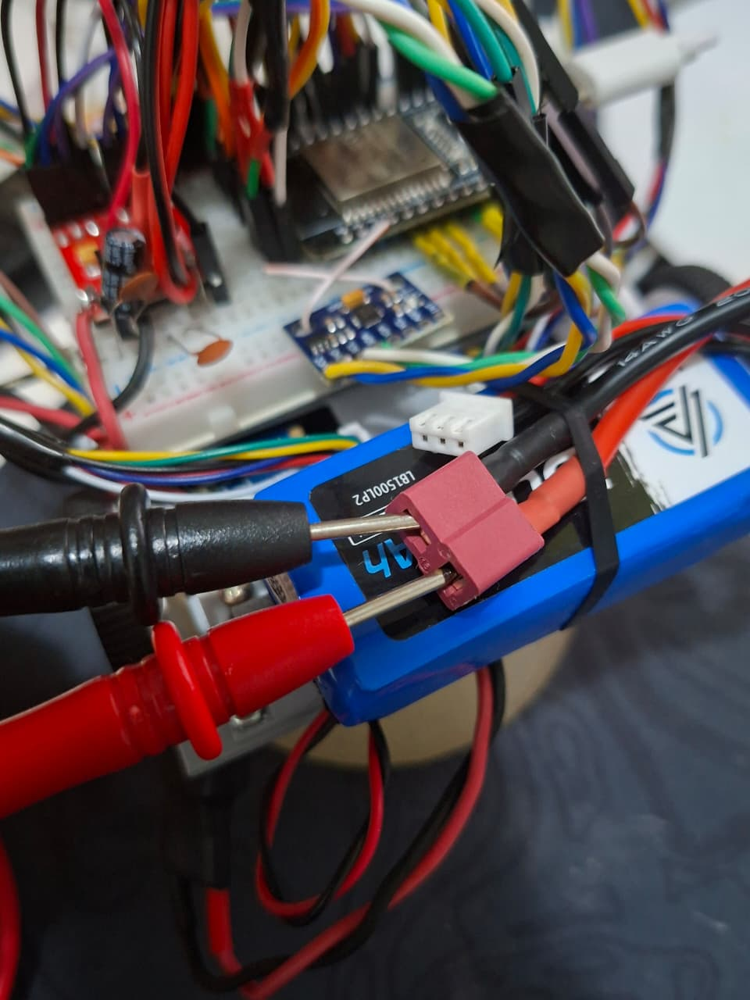
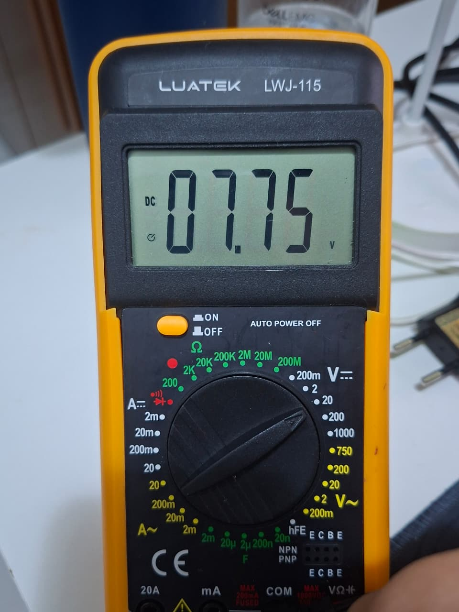

<a id="teste-2-2"></a>

## 2.2 Consumo por componente

O firmware liga os componentes um de cada vez, da etapa E0 à E9. Cada etapa espera 2 s para estabilizar e mede por 5 s (cerca de 500 leituras). O consumo de um componente é a diferença entre a etapa dele e a anterior. A coluna "No trilho" converte essa diferença para a tensão do componente com o rendimento dos reguladores do docs/4.2 (80% no 6 V e no 3,3 V, 85% no 5 V): I<sub>trilho</sub> = I<sub>bateria</sub> × V<sub>bateria</sub> × η ÷ V<sub>trilho</sub>.

| Etapa | Bateria (V) | Corrente média (mA) | Mínima (mA) | Máxima (mA) |
|---|:---:|:---:|:---:|:---:|
| E0 base | 7,48 | 75,5 | 65,4 | 81,5 |
| E1 + MPU6050 | 7,48 | 80,6 | 75,9 | 82,1 |
| E2 + laser esquerdo | 7,47 | 89,9 | 76,7 | 97,4 |
| E3 + laser frontal | 7,45 | 99,8 | 75,4 | 114,0 |
| E4 + laser direito | 7,44 | 109,5 | 76,9 | 128,4 |
| E5 + WiFi ligado | 7,43 | 173,2 | 138,1 | 255,6 |
| E6 + WiFi transmitindo | 7,43 | 180,0 | 144,2 | 255,0 |
| E7 + motor A em 50% | 7,43 | 200,2 | 166,0 | 281,8 |
| E8 motor A em 100% | 7,42 | 210,2 | 165,3 | 290,8 |
| E9 + motor B em 100% | 7,42 | 338,5 | 213,0 | 482,0 |

| Componente | Na bateria (mA) | No trilho (mA) | Trilho | Previsto no docs/4.2 (mA) |
|---|:---:|:---:|:---:|:---:|
| Base: ESP32 sem WiFi, reguladores, encoders, INA219, lógica da ponte H e LED do MPU6050 | 75,5 | - | - | - |
| MPU6050 | 5,1 | 9,3 | 3,3 V | 5 |
| VL53L0X esquerdo | 9,3 | 16,8 | 3,3 V | 20 |
| VL53L0X frontal | 9,9 | 17,9 | 3,3 V | 20 |
| VL53L0X direito | 9,7 | 17,5 | 3,3 V | 20 |
| WiFi ligado, sem transmitir | 63,7 | 80,4 | 5 V | - |
| WiFi transmitindo a 10 Hz | 6,8 | 8,6 | 5 V | - |
| Motor A em 50% | 20,2 | 20,0 | 6 V | - |
| Motor A de 50% para 100% | 10,0 | 9,9 | 6 V | - |
| Motor A em 100% (E8 - E6) | 30,2 | 29,9 | 6 V | 350 com peso do carrinho |
| Motor B em 100% | 128,3 | 126,9 | 6 V | 350 com peso do carrinho |
| **Total na última etapa** | **338,5** | - | - | - |

- A etapa base reúne o que o software não consegue desligar.
- A diferença de cada sensor inclui também o ESP32 lendo esse sensor pelo I2C.
- Com o robô parado e tudo ligado (E6), o consumo foi de 180 mA, contra 162 mA previstos a 7,4 V. Nos ensaios dos outros testes, com o robô parado, ficou entre 171 e 175 mA. Depois da base, o maior consumo é o do WiFi: 89 mA no trilho de 5 V. Tirando da base os itens de 3,3 V (com os valores previstos no docs/4.2) e a corrente parada do LM2596, e somando o WiFi, o ESP32 fica em cerca de 160 mA no trilho de 5 V, contra 135 mA previstos. Isso explica a maior parte da diferença com o robô parado. É uma estimativa, porque a base mistura trilhos.
- Os motores foram medidos sem carga, com as rodas no ar. Na etapa E9 a corrente oscilou de 213 a 482 mA e o motor B ficou 4 vezes acima do A. Nos ensaios seguintes, os dois motores juntos em PWM 255 somaram cerca de 62 mA, então o valor da E9 não representa o motor B em vazio. Para o consumo dos motores valem as medições do 2.3.

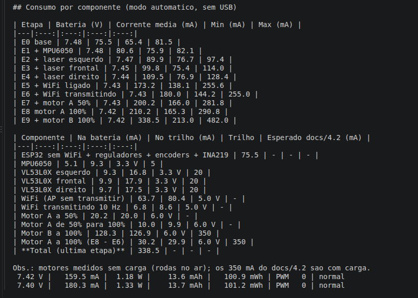

<a id="teste-2-3"></a>

## 2.3 Corrente com os motores girando

| Condição | Parado | Motores em PWM 200 | Só os motores |
|---|:---:|:---:|:---:|
| Rodas no ar | 174,3 mA | 234,1 mA | 59,8 mA |
| Rodas no chão | 174,5 mA | 320,9 mA | 146,4 mA |

As médias excluem o primeiro segundo depois de cada troca de PWM, com a bateria em 7,4 V. O desvio padrão das amostras foi de 19 a 20 mA. A previsão de 866 mA do docs/4.2 considerou os dois motores puxando a corrente nominal de catálogo do N20 (350 mA cada) durante todo o percurso. Mesmo com as rodas no chão, os dois motores juntos puxaram 146 mA, cerca de um quinto dos 700 mA previstos. Os picos de partida chegaram a 410 mA no ar e a 515 mA no chão.

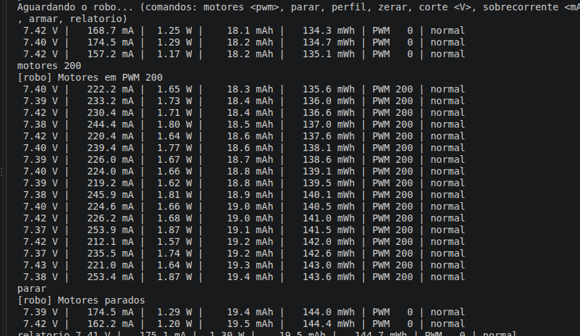
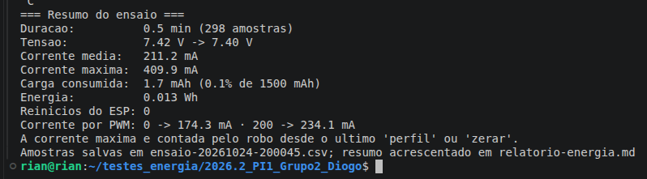

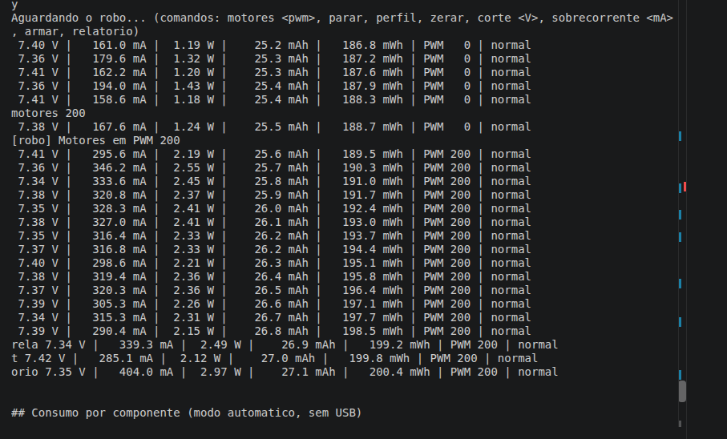
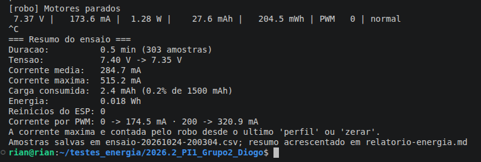

<a id="teste-2-4"></a>

## 2.4 Saída dos reguladores

| Trilho | Regulador | Faixa aceita (±5%) | Medido | Diferença do nominal |
|---|---|:---:|:---:|:---:|
| 6 V | LM2596 | 5,70 a 6,30 V | 5,95 V | -0,8% |
| 5 V | MP1584 | 4,75 a 5,25 V | 5,11 V | +2,2% |
| 3,3 V | MP1584 | 3,14 a 3,47 V | 3,31 V | +0,3% |

Uma leitura por trilho, com o multímetro. O 3,3 V foi medido no pino 3V3 do ESP32 (as duas últimas fotos).

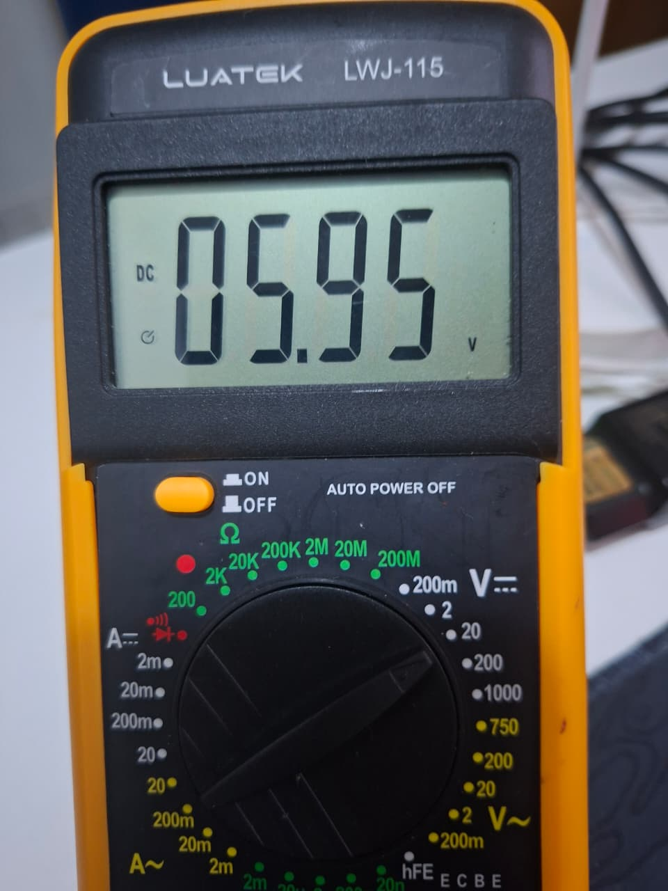
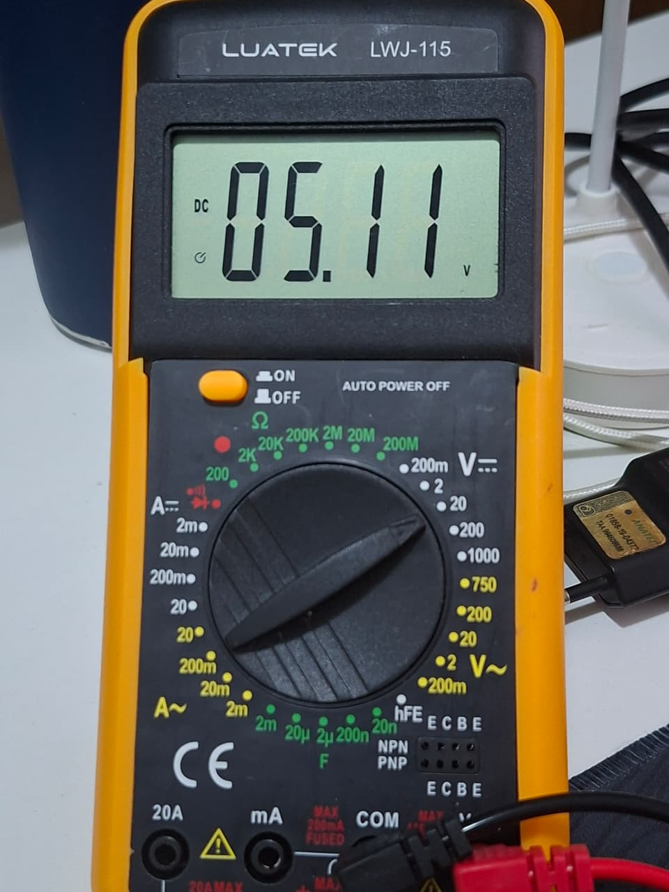
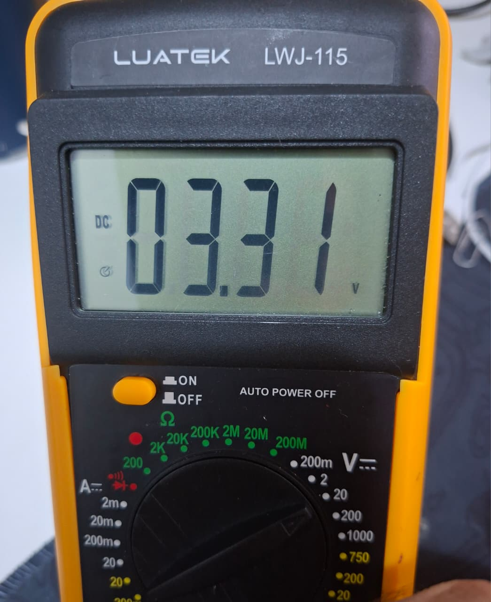
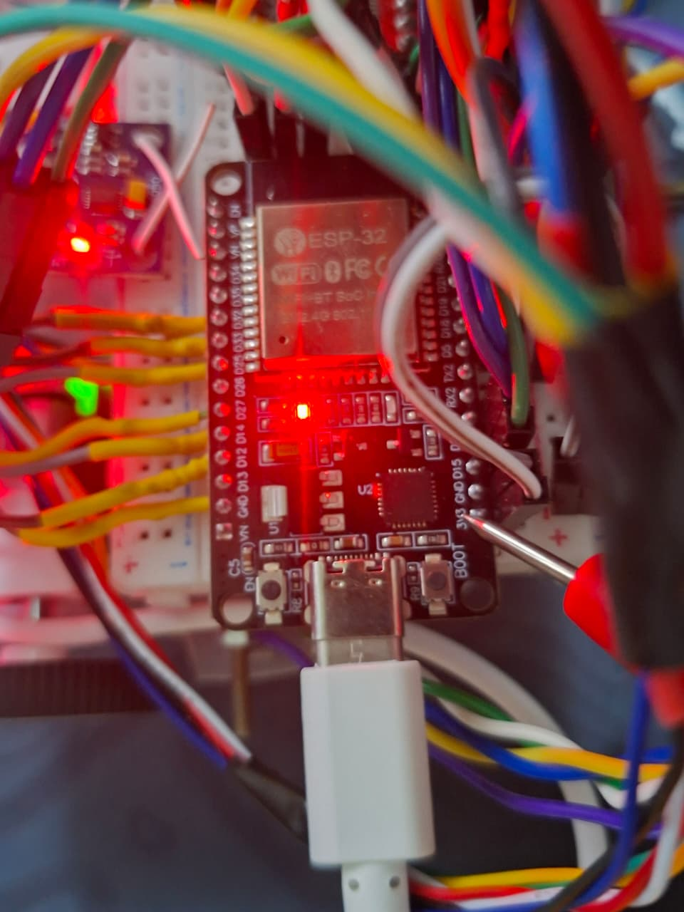

<a id="teste-2-5"></a>

## 2.5 ESP32 não reinicia na partida dos motores

Entre 20:05:22 e 20:06:13, os motores foram ligados em PWM 255 e parados 13 vezes, com 1 a 3 s entre um comando e outro. O firmware de teste guarda um contador de boots na memória do ESP32 e manda, em cada amostra, o número do boot e o motivo do último reset. Um reinício por queda de tensão trocaria o número do boot e apareceria com o motivo "BROWNOUT". O boot ficou em 9 do começo ao fim, com o motivo "ligado". A corrente média em PWM 255 foi de 237 mA, com pico de 988 mA na partida, e a menor tensão registrada foi 7,33 V.

O boot 9 vai das 19:53 às 20:19 e cobre os ensaios do 2.2 ao 2.9, menos o 2.6, que foi feito no boot 8, também sem reinício. Os dois boots começaram com o motivo "ligado", ou seja, o robô foi desligado e ligado de novo, sem reinício por queda de tensão.

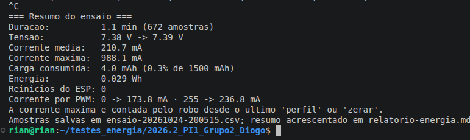

<a id="teste-2-6"></a>

## 2.6 Autonomia de um lançamento

O comando `perfil` zera a carga e a energia e reproduz o lançamento do docs/4.2: 5 min parado e 10 min com os motores em PWM 200. O perfil rodou completo, das 19:10:26 às 19:25:26, sem corte, sem aviso de sobrecorrente e sem reinício.

| Fase | Duração | Corrente média |
|---|:---:|:---:|
| Parado | 5 min | 172,4 mA |
| Motores em PWM 200 | 10 min | 228,8 mA |

| | Previsto no docs/4.2 | Medido (rodas no ar) | Estimado com a corrente do 2.3 no chão |
|---|:---:|:---:|:---:|
| Carga por lançamento | 160 mAh | 52,5 mAh | 68 mAh |
| Energia por lançamento | 1,184 Wh | 0,398 Wh | 0,50 Wh |
| Lançamentos com 80% da bateria (1200 mAh) | 7 | 22 | 17 |

A tensão foi de 7,61 V para 7,55 V, e a maior corrente foi 608 mA. A estimativa no chão troca a corrente com os motores pela medida no 2.3 (320,9 mA). Em todos os casos sobra bateria para os 3 lançamentos da apresentação. O print do receptor mostra 53,5 mAh e 0,406 Wh porque inclui os 22 s depois do fim do perfil. Os valores da tabela são os do fim do perfil, tirados do CSV.

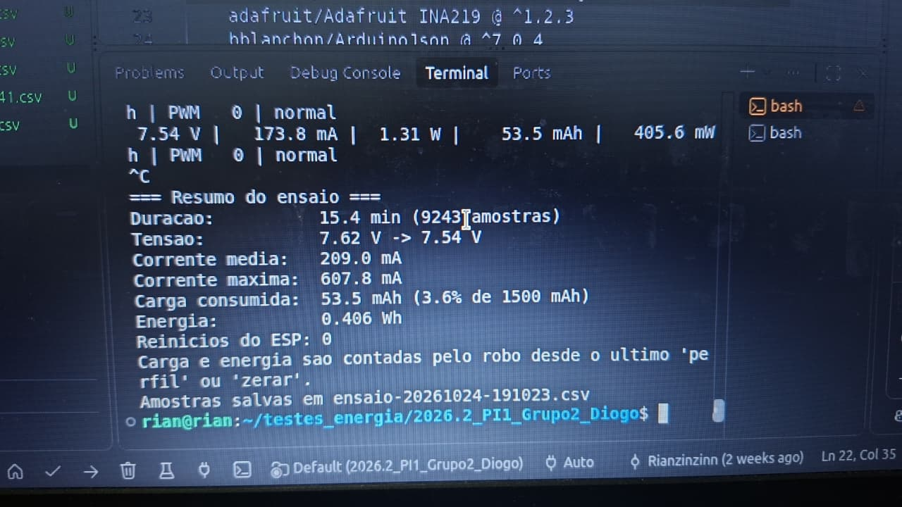

<a id="teste-2-7"></a>

## 2.7 Corte por subtensão

Eventos registrados pelo receptor:

```
20:11:41 Motores em PWM 150
20:11:48 Corte em 8.00 V (padrao 6.6 V)
20:11:50 Bateria critica: 7.34 V, motores cortados
20:11:58 Corte em 6.60 V (padrao 6.6 V)
```

No CSV, o estado passou de "normal" para "CRITICA" às 20:11:50,7, e o PWM foi de 150 para 0 na mesma amostra. Os motores ficaram parados até o comando `corte` sem valor, que voltou o limite para 6,6 V e reiniciou o monitor. O firmware de teste reinicia o monitor de propósito, para o teste poder ser repetido. No firmware do robô, o estado crítico fica travado até o robô ser desligado, o que é verificado pelo teste automatizado `test_corte_fica_travado_mesmo_se_tensao_subir` (`test/test_power_logic`).

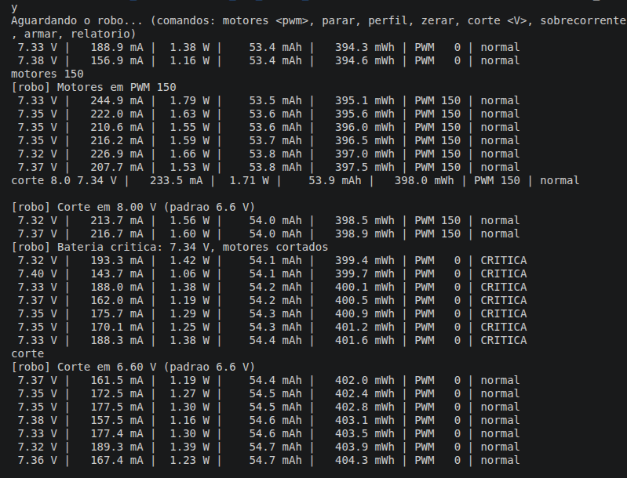
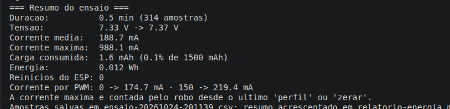

<a id="teste-2-8"></a>

## 2.8 Queda rápida não corta

Com os limites padrão, os motores foram ligados em PWM 255 e parados 5 vezes às 20:14 e 8 vezes às 20:16, estas com cerca de 1 s entre um comando e outro. O estado da bateria ficou "normal" nos dois ensaios. A maior corrente foi 1042 mA, e a menor tensão registrada foi 7,29 V. Como as quedas ficaram longe do alerta (7,0 V) e do corte (6,6 V), o teste mostra que as partidas não geram alerta falso, mas não chega a testar a confirmação de 2 s. Essa confirmação é verificada pelo teste automatizado `test_queda_curta_no_pico_nao_corta` (`test/test_power_logic`).

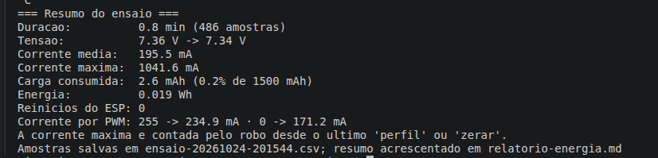

<a id="teste-2-9"></a>

## 2.9 Aviso de sobrecorrente

Eventos registrados pelo receptor:

```
20:19:06 Motores em PWM 255
20:19:31 Aviso de sobrecorrente em 100 mA (padrao 2000 mA)
20:19:32 Sobrecorrente: 253 mA
20:19:44 Aviso de sobrecorrente em 2000 mA (padrao 2000 mA)
```

No CSV, o aviso aparece às 20:19:32,25 e some às 20:19:44,25, quando o limite volta a 2000 mA. Os motores continuaram girando, porque a sobrecorrente é só um aviso, e o estado da bateria seguiu "normal".

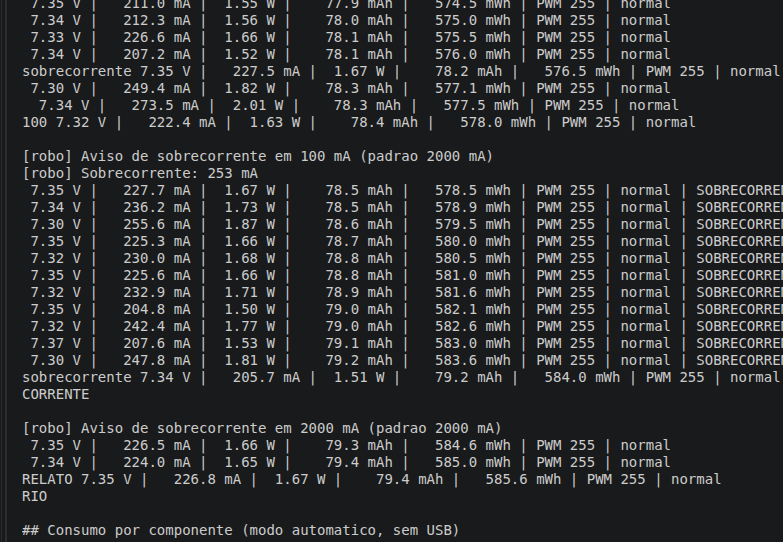
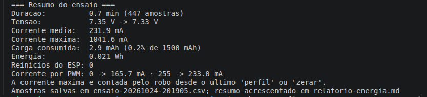
