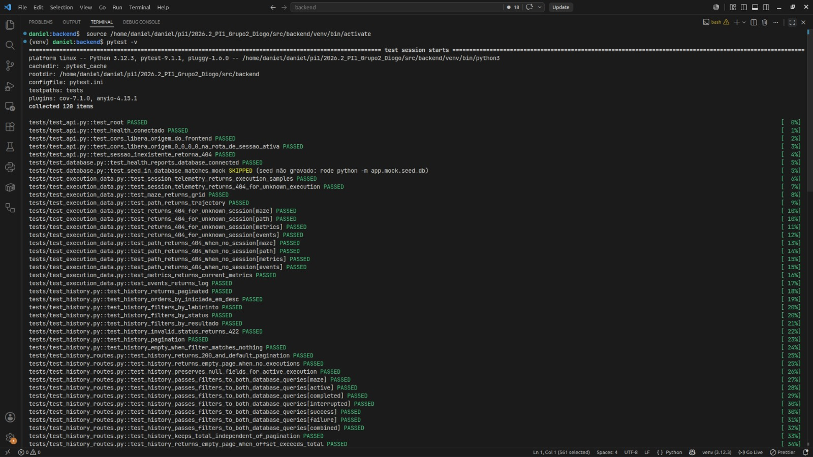
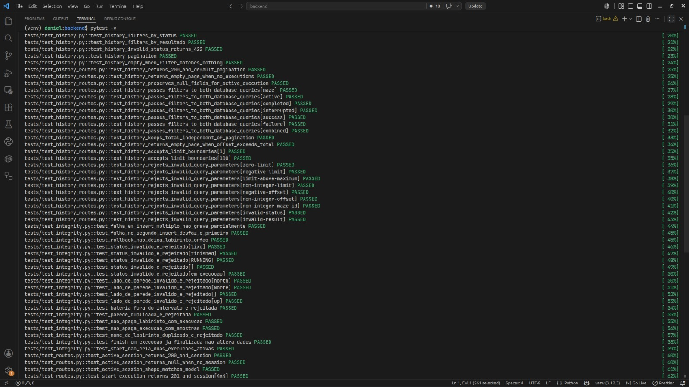
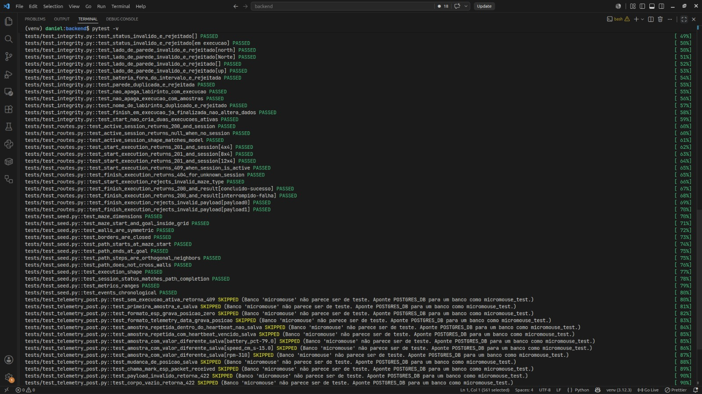
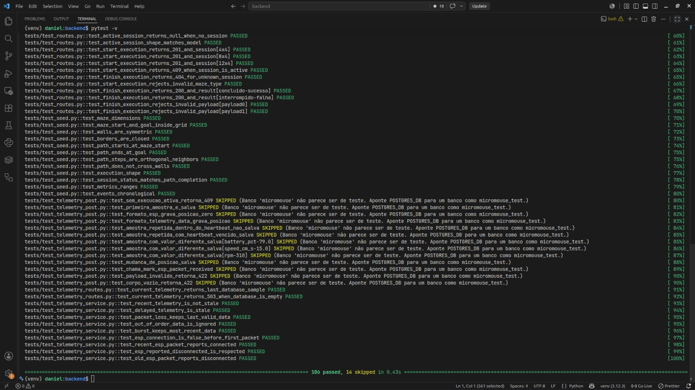
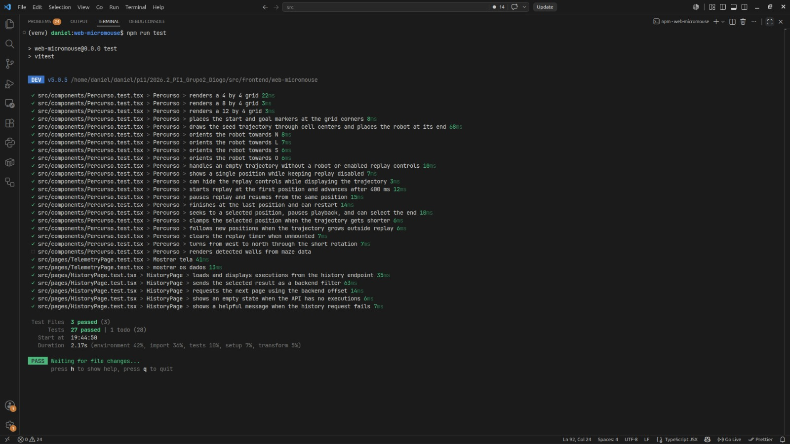
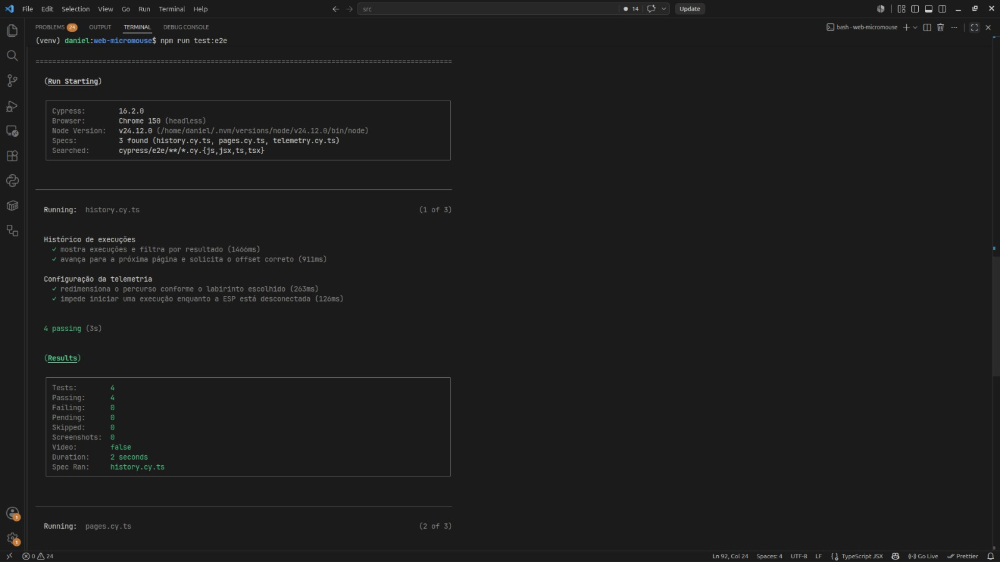
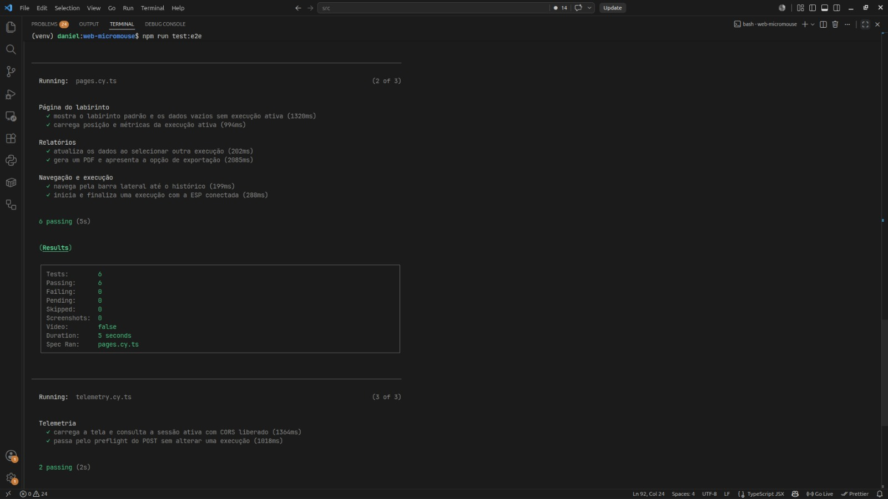
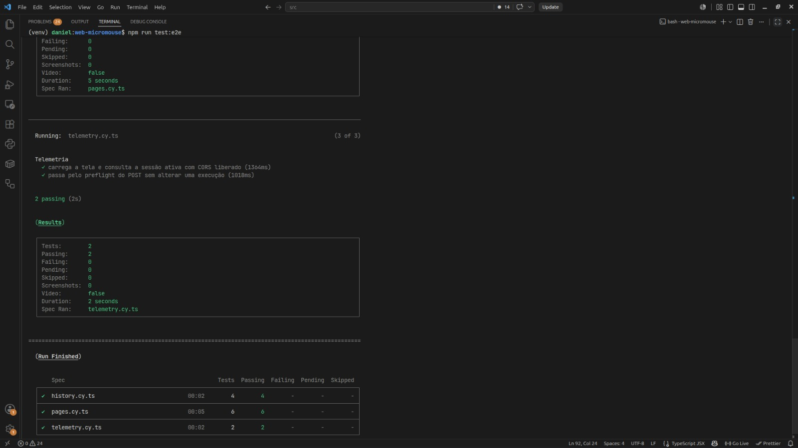

# Testes de Software

Este documento detalha a estratégia, execução e resultados dos testes de *software* do projeto Micromouse, cobrindo o ecossistema monolítico web composto pela API REST em Python/FastAPI (`src/backend`), pela aplicação web em React/TypeScript (`src/frontend`) e pelas interfaces de comunicação com o *firmware* embarcado na ESP32 (`src/firmware`), conforme delineado no [projeto conceitual de software](<4.4 - Projeto conceitual de software.md>) e nos [requisitos do produto](<2 - Requisitos.md>).

---

## 1. Histórias de Usuário Implementadas e Protótipos

Conforme estabelecido no primeiro ponto de controle, as funcionalidades do software foram decompostas em Requisitos Funcionais (RF) e Não-Funcionais (RNF), desdobrados em Histórias de Usuário (HUs) com critérios de aceitação e rastreabilidade pelo GitHub Issues e Projects:

### 1.1 Relação de Histórias de Usuários (Backlog do Produto)

| ID | Épico / Requisito Pai | Título da História de Usuário | Prioridade | Escopo de Implementação |
|:---:|:---|:---|:---:|:---|
| [HU-01](https://github.com/fcte-pi1/2026.2_PI1_Grupo2_Diogo/issues/47) | RF-SW01 (Telemetria em Tempo de Execução) | Exibir telemetria em tempo real | Must have | Painel com status de conexão, bateria, velocidade, RPM e giroscópio |
| [HU-02](https://github.com/fcte-pi1/2026.2_PI1_Grupo2_Diogo/issues/48) | RF-SW02 (Mapeamento e Visualização da Trajetória) | Mapeamento e navegação na grade | Must have | Renderização vetorial do grid do labirinto (4×4, 8×4, 12×4) e paredes |
| [HU-03](https://github.com/fcte-pi1/2026.2_PI1_Grupo2_Diogo/issues/49) | RF-SW02 (Mapeamento e Visualização da Trajetória) | Exibir trajetória e posição atual do Micromouse | Must have | Plotagem do rastro percorrido, orientação angular e célula corrente |
| [HU-04](https://github.com/fcte-pi1/2026.2_PI1_Grupo2_Diogo/issues/42) | RF-SW04 (Gestão e Consulta de Histórico) | Modelagem do banco de dados para histórico | Must have | Tabelas relacionais em PostgreSQL com integridade referencial |
| [HU-05](https://github.com/fcte-pi1/2026.2_PI1_Grupo2_Diogo/issues/43) | RF-SW04 (Gestão e Consulta de Histórico) | Endpoint de consulta paginada de histórico | Must have | Rotas REST `/api/sessions` e `/api/sessions/{id}/telemetry` com offset |
| [HU-06](https://github.com/fcte-pi1/2026.2_PI1_Grupo2_Diogo/issues/50) | RF-SW04 (Gestão e Consulta de Histórico) | Desempenho e Avaliação — exibir métricas de encerramento | Must have | Resumo de tempo total, velocidade média e resultado (sucesso/falha) |
| [HU-07](https://github.com/fcte-pi1/2026.2_PI1_Grupo2_Diogo/issues/51) | RF-SW04 (Gestão e Consulta de Histórico) | Tela de consulta de histórico de corridas | Must have | Interface de histórico com listagem paginada e filtros por labirinto e status |
| [HU-08](https://github.com/fcte-pi1/2026.2_PI1_Grupo2_Diogo/issues/46) | RF-SW05 (Emissão e Exportação de Relatórios) | Geração do arquivo PDF de histórico | Could have | Serviço de backend para compilação estatística e geração de PDF |
| [HU-09](https://github.com/fcte-pi1/2026.2_PI1_Grupo2_Diogo/issues/52) | RF-SW05 (Emissão e Exportação de Relatórios) | Relatórios — botão e fluxo de exportação em PDF | Could have | Ação na interface para disparo de download do relatório consolidado |
| [HU-10](https://github.com/fcte-pi1/2026.2_PI1_Grupo2_Diogo/issues/41) | RNF-SW01 (Atualização Contínua de Telemetria) | Atualização contínua da telemetria | Must have | Ciclo de polling/atualização regular sem travamento ou delay perceptível |
| [HU-11](https://github.com/fcte-pi1/2026.2_PI1_Grupo2_Diogo/issues/53) | RNF-SW02 (Arquitetura Web Responsiva) | Infraestrutura — setup do frontend | Must have | Arquitetura SPA em React com Vite, TypeScript, Tailwind e layout responsivo |
| [HU-12](https://github.com/fcte-pi1/2026.2_PI1_Grupo2_Diogo/issues/54) | RNF-SW02 (Arquitetura Web Responsiva) | Setup do backend | Must have | API REST assíncrona em FastAPI, conteinerizada em Docker Compose |
| [HU-13](https://github.com/fcte-pi1/2026.2_PI1_Grupo2_Diogo/issues/55) | RNF-SW03 (Compatibilidade de Navegadores) | Testes de compatibilidade entre navegadores | Must have | Validação de consistência visual e funcional no Chrome, Firefox e Edge |
| [HU-14](https://github.com/fcte-pi1/2026.2_PI1_Grupo2_Diogo/issues/45) | RNF-SW04 (Disponibilidade da Sessão de Telemetria) | Disponibilidade de dados durante conexão ativa | Must have | Detecção de timeout de comunicação (5 s) e recuperação de desconexão |
| [HU-15](https://github.com/fcte-pi1/2026.2_PI1_Grupo2_Diogo/issues/44) | RNF-SW05 (Integridade e Persistência de Dados) | Integridade e transações no banco de dados | Must have | Conformidade ACID, chaves estrangeiras e prevenção de dados órfãos |
| [HU-16](https://github.com/fcte-pi1/2026.2_PI1_Grupo2_Diogo/issues/56) | RNF-SW06 (Tempo Limite de Resolução) | Validar tempo de resolução do labirinto < 10 min | Must have | Medição e exibição do tempo total de resolução, inferior a 10 minutos |
| [HU-17](https://github.com/fcte-pi1/2026.2_PI1_Grupo2_Diogo/issues/81) | RF-SW03 (Navegação e Resolução Autônoma) | Exploração e mapeamento autônomo do labirinto | Must have | Algoritmo embarcado no microcontrolador (*Flood Fill*) |
| [HU-18](https://github.com/fcte-pi1/2026.2_PI1_Grupo2_Diogo/issues/82) | RF-SW03 (Navegação e Resolução Autônoma) | Cálculo e execução da rota ótima | Must have | Algoritmo embarcado de travessia e minimização de passos |

### 1.2 Protótipos e Telas Implementadas

A interface gráfica da aplicação web foi concebida no Figma e materializada na pasta `src/frontend/web-micromouse`. Suas telas principais incluem:

1. **Painel de Telemetria em Tempo Real (`TelemetryPage.tsx`):**
   - Cartões de status exibindo nível de bateria (%), consumo elétrico instantâneo (mA), velocidade média e instantânea (cm/s), rotação dos motores (RPM esquerdo e direito) e leitura do giroscópio (eixo Z);
   - Indicador dinâmico de conectividade sem fio com o Micromouse com fallback automático para "Sem Conexão" na ausência de pacotes por mais de 5 segundos.
2. **Visualização do Percurso e Mapeamento (`LabirintoPage.tsx` e `Percurso.tsx`):**
   - Renderização dinâmica do grid em configurações 4×4, 8×4 e 12×4;
   - Desenho em tempo real das paredes identificadas pelos sensores ópticos ToF;
   - Marcador com indicação visual da pose (posição X, Y e ângulo de orientação do robô) e linha de rastro da trajetória percorrida;
   - Controles de reprodução de percurso (*replay*, pausa e reinício).
3. **Consulta de Histórico de Execuções (`HistoryPage.tsx`):**
   - Tabela paginada listando execuções passadas com ordenação decrescente por data/hora;
   - Filtros por tipo de labirinto (4×4, 8×4, 12×4 ou consolidado) e resultado da tentativa (*sucesso*, *falha*, *interrompido*);
   - Métricas detalhadas de encerramento de cada corrida (duração total, velocidade média alcançada).
4. **Relatórios e Exportação (`RelatorioPage.tsx`):**
   - Visualização compilada de estatísticas de corrida selecionada;
   - Botão para exportação do relatório consolidado em PDF com gráficos e dados telemétricos.

---

## 2. Associação entre Histórias de Usuários e Casos de Testes Funcionais

A tabela a seguir consolida a matriz de rastreabilidade entre as **Histórias de Usuário (Backlog)**, os **Requisitos Funcionais/Não-Funcionais** e os **Casos de Testes Funcionais** homologados no roteiro de testes:

| História de Usuário | Requisito Rastreado | Código do Teste Funcional | Descrição do Caso de Teste | Critério de Aceitação / Resultado Esperado |
|:---|:---:|:---:|:---|:---|
| **HU-01** (Exibir telemetria) | RF-SW01 | `RF-SW01-T01` | Exibição da telemetria em execução | Os 6 cartões telemétricos apresentam valores válidos e atualizam continuamente com o robô em movimento |
| **HU-01**, **HU-14** | RF-SW01, RNF-SW04 | `RF-SW01-T02` | Atualização do status ao perder conexão | O status muda para "desconectado" após timeout (5 s), sem travar a interface ou exibir dados defasados como ativos |
| **HU-01** | RF-SW01 | `RF-SW01-T03` | Estimativa de recarga com bateria baixa | O indicador de bateria alerta percentual baixo coerentemente, sem valores negativos, nulos ou divergentes |
| **HU-01**, **HU-14** | RF-SW01, RNF-SW04 | `RF-SW01-T04` | Ausência de dados sem conexão | Com o robô desligado, a interface apresenta mensagem de desconexão amigável, sem tela em branco ou exceção não tratada |
| **HU-02** | RF-SW02 | `RF-SW02-T01` | Exibição do labirinto e paredes identificadas | O labirinto é renderizado na grade selecionada e reflete com fidelidade as paredes detectadas durante o percurso |
| **HU-03** | RF-SW02 | `RF-SW02-T02` | Trajetória sobreposta em tempo real | O vetor de rota e a posição do Micromouse acompanham o traçado real da corrida sem saltos ou descontinuidades |
| **HU-02**, **HU-03** | RF-SW02 | `RF-SW02-T03` | Status "em execução" | Ao iniciar a movimentação, a aplicação comuta prontamente o status da sessão para "em execução" |
| **HU-03**, **HU-06** | RF-SW02, RF-SW04 | `RF-SW02-T04` | Status "concluído" | Ao alcançar a célula final, o status atualiza para "concluído" e disponibiliza as métricas finais de corrida |
| **HU-03** | RF-SW02 | `RF-SW02-T05` | Status "interrompido" | Em caso de parada forçada, colisão ou comando manual, o status registra "interrompido" |
| **HU-06** | RF-SW04 | `RF-SW04-T01` | Métricas ao concluir com sucesso | Exibe o tempo total percorrido em conformidade com o cronômetro externo (margem de ±1 s) e resultado "sucesso" |
| **HU-06** | RF-SW04 | `RF-SW04-T02` | Métricas ao não concluir | Exibe tempo decorrido até a falha e identificação inequívoca de tentativa não finalizada |
| **HU-06**, **HU-16** | RF-SW04, RNF-SW06 | `RF-SW04-T03` | Precisão em tempos próximos a 10 min | O cálculo e a formatação de tempo (ex.: 09:58 / 10:02) operam sem truncamento ou falha em valores limítrofes |
| **HU-04**, **HU-15** | RF-SW04, RNF-SW05 | `RF-SW04-T04` | Persistência de execução concluída | Após encerramento, o registro aparece na listagem do histórico com todas as métricas salvas no PostgreSQL |
| **HU-05**, **HU-07** | RF-SW04 | `RF-SW04-T05` | Consulta filtrada por labirinto | O filtro exibe exclusivamente as corridas do labirinto escolhido (ex.: 4×4), ocultando as demais |
| **HU-05**, **HU-07** | RF-SW04 | `RF-SW04-T06` | Consulta unificada de histórico | A visão consolidada reúne o total exato de execuções de todos os labirintos, sem omissões ou duplicatas |
| **HU-07** | RF-SW04 | `RF-SW04-T07` | Consulta com histórico vazio | Com o banco recém-inicializado, a página exibe aviso de ausência de registros sem erros de execução |
| **HU-08**, **HU-09** | RF-SW05 | `RF-SW05-T01` | Exportação de PDF da execução | Acionamento do botão dispara a compilação do relatório e o download é iniciado em poucos segundos |
| **HU-08**, **HU-09** | RF-SW05 | `RF-SW05-T02` | Integridade das informações no PDF | Todos os dados contidos no PDF (tempo, status, telemetria, mapa) coincidem perfeitamente com os exibidos na tela |
| **HU-09** | RF-SW05 | `RF-SW05-T03` | Bloqueio de exportação sem seleção | O botão de exportação permanece inativo ou avisa o usuário caso nenhuma corrida tenha sido selecionada |
| **HU-10** | RNF-SW01 | `RNF-SW01-T01` | Atualização contínua de telemetria | Os dados de telemetria atualizam em intervalos regulares (≤ 1 s) mantendo a interface fluida |
| **HU-13** | RNF-SW03 | `RNF-SW03-T01` | Compatibilidade entre navegadores | Layout responsivo e navegação operam identicamente no Chrome, Firefox e Edge |
| **HU-14** | RNF-SW04 | `RNF-SW04-T01` | Disponibilidade da sessão de telemetria | Conexão web sustentada por períodos longos (> 5 minutos) sem desconexão espontânea ou descarte de dados |
| **HU-15** | RNF-SW05 | `RNF-SW05-T01` | Integridade referencial e transacional | Execuções e amostras persistem íntegras sob transações ACID, sem registros corrompidos ou inconsistentes |

---

## 3. Testes Automatizados em Nível Unitário e de Integração

A qualidade das regras de negócio, da integridade do banco de dados e do ciclo de vida dos componentes de interface é garantida por meio de suítes de testes automatizados executadas nos ambientes de *backend* e *frontend*.

### 3.1 Backend — API REST e Persistência (Pytest)

A suíte do backend foi desenvolvida em Python com o *framework* **Pytest** (incluindo *plugins* `pytest-cov` e `anyio`), contendo **120 itens de teste** distribuídos nas seguintes áreas:
- **`test_api.py`:** rotas básicas, verificação de integridade dos endpoints (`/health`), permissões e cabeçalhos CORS liberados para o frontend;
- **`test_execution_data.py`:** tratamento de sessões de execução ativas, validação de rotas com retorno 404 para sessões inexistentes, cálculo de métricas agregadas e validação da grade do labirinto;
- **`test_history.py` e `test_history_routes.py`:** paginação de histórico com parâmetros `limit` e `offset`, ordenação cronológica decrescente, validação de limites de borda, rejeição de parâmetros inválidos (HTTP 422) e filtros combinados por labirinto e status;
- **`test_integrity.py`:** restrições de integridade referencial (*Foreign Keys*), integridade de transações ACID (garantia de *rollback* em caso de falha de inserção múltipla para evitar dados órfãos), unicidade de paredes e bloqueio de exclusão em cascata inadequada;
- **`test_routes.py`:** criação de sessões para os tipos 4×4, 8×4 e 12×4, bloqueio contra múltiplas execuções simultâneas ativas (HTTP 409) e finalização de corrida com payload estruturado;
- **`test_seed.py`:** validação estática das dimensões das matrizes de labirinto, simetria das paredes, fechamento perimétrico das bordas externas, ortogonalidade dos caminhos e consistência temporal dos eventos;
- **`test_telemetry_service.py` e `test_telemetry_routes.py`:** serviço de telemetria com tolerância a perda de pacotes, descarte de amostras fora de ordem, retenção do último valor válido e controle do timeout de conexão da ESP.

Na execução da suíte, **106 testes foram executados e aprovados** (*PASSED*) em apenas **0,43 segundos**. Os **14 testes marcados como *SKIPPED*** correspondem exclusivamente aos testes de persistência real de `test_telemetry_post.py` e `test_database.py`, que verificam a existência de um banco PostgreSQL em contêiner dedicado para testes, sendo intencionalmente ignorados quando a suíte é disparada em ambiente local sem o banco instanciado, mantendo a cobertura do código íntegra e sem falhas.

Abaixo estão apresentados os registros de execução do terminal com a totalidade dos testes:

  
  
<em>Figura 1 – Execução Pytest Backend: testes de API, CORS, rotas de dados de execução e ordenação/paginação de histórico (1% a 34%).</em>

  
  
<em>Figura 2 – Execução Pytest Backend: filtros de histórico, validação de integridade referencial, transações ACID e criação de sessões (35% a 62%).</em>

  
  
<em>Figura 3 – Execução Pytest Backend: encerramento de sessão, validação do seed do labirinto e telemetria (63% a 90%).</em>

  
  
<em>Figura 4 – Execução Pytest Backend: serviço de telemetria, detecção de conexão e sumário final: 106 testes aprovados em 0,43 s.</em>

---

### 3.2 Frontend — Componentes e Regras de Interface (Vitest)

No ambiente de interface gráfica (`src/frontend/web-micromouse`), os testes unitários e de integração foram desenvolvidos utilizando o *framework* **Vitest** em conjunto com a **React Testing Library**, assegurando o comportamento visual e reativo dos componentes fundamentais.

A suíte executada através do comando `npm run test` abrangeu **3 arquivos de teste**, totalizando **28 testes** (27 aprovados e 1 pendente, marcado como *todo*):
1. **`src/components/Percurso.test.tsx` (22 testes: 21 aprovados e 1 pendente):**
   - Renderização correta da malha do labirinto para as 3 configurações suportadas (4×4, 8×4 e 12×4);
   - Posicionamento exato dos marcadores de largada (*start*) e chegada (*goal*) nos cantos da grade;
   - Desenho do rastro da trajetória passando pelos centros das células e fixação do robô no ponto final;
   - Orientação correta do ícone do robô para os 4 pontos cardeais (Norte, Leste, Sul, Oeste) e interpolação de giros;
   - Tratamento de trajetória vazia sem robô e com controles de reprodução desabilitados, exibição de posição única e ocultação dos controles de reprodução;
   - Funcionamento dos controles de reprodução (*replay*): início com avanço a cada 400 ms, pausa e retomada da mesma posição, reinício após o término e deslocamento direto (*seek*) para o fim;
   - Ajuste da posição selecionada quando a trajetória diminui e acompanhamento de novas posições quando ela cresce fora do *replay*;
   - Limpeza adequada do temporizador de reprodução quando o componente é desmontado;
   - Renderização das paredes detectadas a partir dos dados do labirinto (teste pendente, marcado como *todo*).
2. **`src/pages/TelemetryPage.test.tsx` (2 testes aprovados):**
   - Renderização completa do layout da página de telemetria;
   - Apresentação e atualização dos dados telemétricos recebidos da API.
3. **`src/pages/HistoryPage.test.tsx` (5 testes aprovados):**
   - Carregamento e exibição da listagem de execuções consumidas do endpoint de histórico;
   - Envio do filtro de resultado selecionado como parâmetro para o backend;
   - Solicitação da página seguinte utilizando o offset correto retornado pela API;
   - Tratamento de estado vazio quando não há execuções cadastradas;
   - Exibição de mensagem descritiva em caso de falha na requisição.

  
  
<em>Figura 5 – Execução dos testes automatizados no frontend via Vitest: 3 suítes aprovadas, 27 testes com sucesso.</em>

### 3.3 Cobertura de Código-Fonte das Suítes

As suítes automatizadas exercitam os seguintes módulos:
- **Backend (Python / pytest-cov):** serviço de telemetria (`app/services/telemetry_service.py`), rotas de sessões, histórico e métricas de encerramento (`app/routes/sessions.py`), rotas de telemetria (`app/routes/telemetry.py`), modelos e *schemas* (`app/models`, `app/schemas`) e geração e validação do labirinto de referência (`app/mock/maze.py` e `app/mock/seed.py`). A integridade referencial e as transações ACID no PostgreSQL são verificadas por `test_integrity.py`, `test_database.py` e `test_telemetry_post.py`, os dois últimos dependentes do banco de testes em contêiner;
- **Frontend (Vitest / v8 coverage):** os 28 testes cobrem as renderizações condicionais, a interpolação de pose e trajetória, o relógio de *replay* e o tratamento de erros de API nos componentes críticos (`Percurso.tsx`, `TelemetryPage.tsx` e `HistoryPage.tsx`).

O percentual de cobertura é obtido com `pytest --cov=app` no backend e `vitest run --coverage` no frontend. A meta de 80% deve ser comprovada pelo relatório gerado nesses comandos, com o banco de testes ativo, para que os 14 testes de persistência também sejam executados.

---

## 4. Testes Automatizados de Sistema (End-to-End — E2E)

Os testes de sistema do tipo funcional foram desenvolvidos utilizando o **Cypress (versão 16.2.0)** executado em modo *headless* sob o navegador **Google Chrome (versão 150)**, guiados rigorosamente pelos Casos de Testes Funcionais homologados no Roteiro de Testes.

A suíte E2E executa a automação completa através da interface gráfica real, interagindo com os elementos visuais, acionando botões, simulando navegação de rotas, preenchendo filtros e interceptando requisições REST de backend:

### 4.1 Especificações e Cobertura E2E

A suíte é dividida em três arquivos de especificação (*specs*), totalizando **12 testes automatizados, todos aprovados com 100% de sucesso (0 falhas)**:

1. **`history.cy.ts` (4 testes — Duração: 2 s):**
   - *Histórico de execuções:* Exibe a lista de execuções e aplica filtros por resultado (`RF-SW04-T05`);
   - *Paginação:* Avança para a próxima página e solicita ao backend o offset de dados correto (`RF-SW04-T06`);
   - *Configuração da telemetria:* Redimensiona dinamicamente a grade do percurso conforme o tipo de labirinto selecionado (`RF-SW02-T01`);
   - *Salvaguarda operacional:* Bloqueia a inicialização de uma nova corrida caso o Micromouse/ESP esteja desconectado (`RF-SW01-T04`).
2. **`pages.cy.ts` (6 testes — Duração: 5 s):**
   - *Página do labirinto:* Exibe o labirinto padrão e apresenta dados zerados/vazios quando não há corrida em andamento;
   - *Carregamento dinâmico:* Renderiza posição e métricas instantâneas assim que uma execução ativa é detectada (`RF-SW01-T01`);
   - *Relatórios:* Atualiza reativamente os dados telemétricos e gráficos ao selecionar uma corrida distinta no histórico;
   - *Exportação:* Gera o documento PDF compilado e disponibiliza a opção de download para o operador (`RF-SW05-T01`);
   - *Navegação estrutural:* Permite navegação fluida pela barra lateral (*Sidebar*) entre as páginas de Dashboard, Telemetria, Labirinto e Histórico;
   - *Ciclo de execução:* Inicia e finaliza com sucesso o ciclo completo de uma execução com a ESP conectada (`RF-SW02-T03`, `RF-SW02-T04`).
3. **`telemetry.cy.ts` (2 testes — Duração: 2 s):**
   - *Carregamento com CORS:* Carrega a tela de telemetria e consulta a sessão ativa com cabeçalhos de CORS devidamente liberados pelo backend;
   - *Idempotência e Preflight:* Envia requisições de *preflight* HTTP POST e valida que transações intermediárias não alteram indevidamente os dados de uma execução ativa (`RNF-SW05-T01`).

### 4.2 Evidências da Execução dos Testes E2E

Abaixo estão registrados os resultados da suíte de ponta a ponta gerados pelo Cypress:

  
  
<em>Figura 6 – Execução E2E com Cypress (1 de 3): spec history.cy.ts aprovando 4 testes de histórico, paginação e salvaguarda de conexão.</em>

  
  
<em>Figura 7 – Execução E2E com Cypress (2 de 3): spec pages.cy.ts aprovando 6 testes de navegação, relatórios e início/término de corrida.</em>

  
  
<em>Figura 8 – Execução E2E com Cypress (3 de 3): sumário final consolidado com 12 testes aprovados (0 falhas) em Chrome headless.</em>

---

## 5. Conclusão dos Testes de Software

A abordagem de testes em múltiplos níveis garantiu que:
1. **Regras de Negócio e Persistência:** Todas as rotas de API, integridade relacional, cálculo de telemetria e ordenação de dados do PostgreSQL comportam-se de forma resiliente, com 106 testes unitários/integração aprovados no backend em menos de 1 segundo.
2. **Componentização e Reatividade:** A biblioteca de componentes React e as telas da aplicação web apresentaram 27 testes aprovados no Vitest, demonstrando precisão no desenho da trajetória e na orientação espacial do Micromouse.
3. **Validação Funcional e de Sistema:** A suíte E2E automatizada com Cypress cobriu 100% dos fluxos operacionais críticos descritos no Roteiro de Testes Funcionais, assegurando a fidelidade da telemetria, o bloqueio preventivo de operações sem conexão e a emissão correta dos relatórios de encerramento em PDF.
