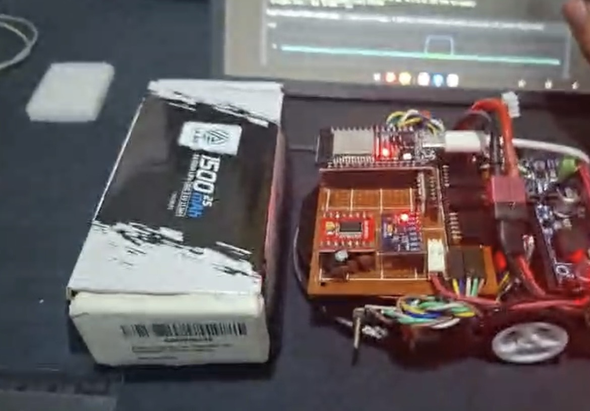
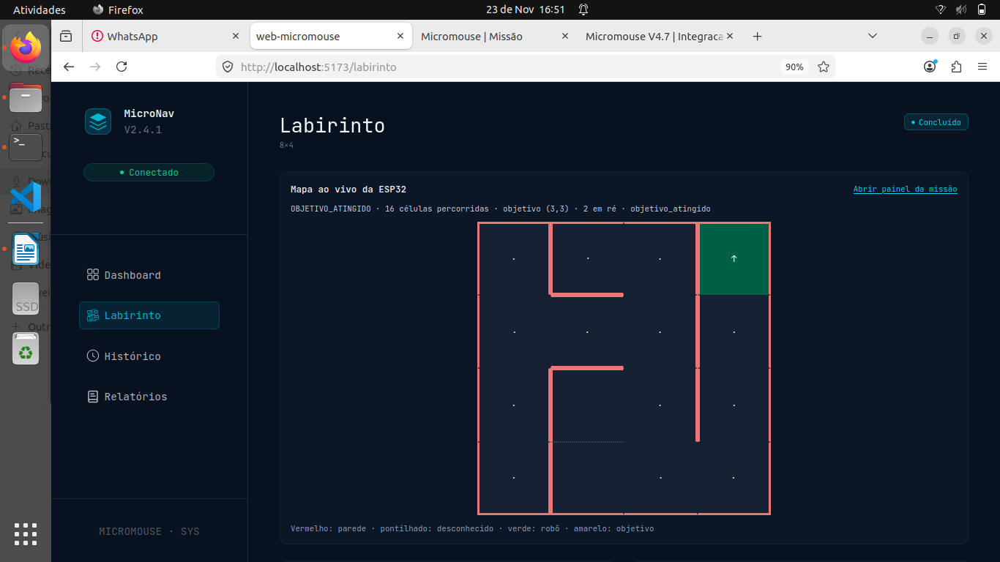
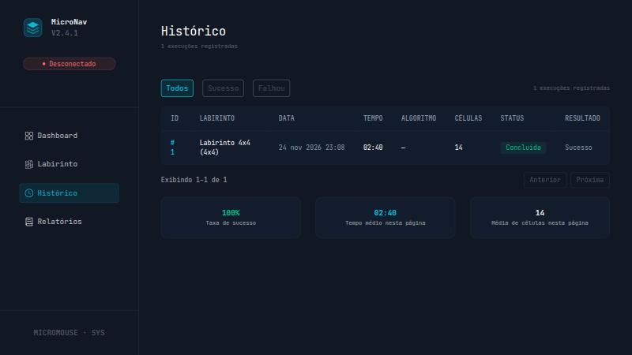
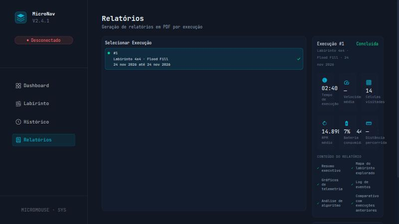

# Testes de Integração

Confiram as regras de avaliação dos testes de integração no [documento do tema do projeto](https://docs.google.com/presentation/d/1hRx0g9mpVGQbTv44gLEoAyf4b4kKM4vnrABTnG8HlUk/edit?usp=sharing).

Os testes de integração reúnem os subsistemas já testados isoladamente ([estrutura](<7.1 - Testes de estrutura.md>), [energia](<7.2 - Testes de energia.md>), [hardware](<7.3 - Testes de hardware.md>) e [software](<7.4 - Testes de software.md>)) e verificam o robô completo funcionando: do chassi montado até a corrida no labirinto, com a telemetria exibida no sistema web e a corrida gravada no banco de dados.

**Resultado principal:** na avaliação de integração, o robô resolveu o labirinto **4x4 na primeira tentativa, em 2 min 40 s**, com os dados exibidos ao vivo no sistema web e gravados no banco (teste 5.15). O vídeo da corrida está na seção [Evidências](#evidências).

| **ID** | **Descrição** | **Data de Início** | **Data de Conclusão** | **Sub-equipes** | **Responsável** | **Resultados Esperados** | **Resultados Obtidos** | **Aprovação Interna (S/N)** | **Aprovação do Orientador (S/N)** | **Observações** |
|:------:|---------------|--------------------|-----------------------|----------------|-----------------|--------------------------|------------------------|:---------------------------:|:--------------------------------:|-----------------|
| 5.1 | **Eletrônica montada no chassi.** Montar a eletrônica em protoboard, calibrar os sensores em bancada e fixar o conjunto no chassi impresso em 3D. | 09/10/2026 | 24/11/2026 | Estrutura; Eletrônica; Energia | Pedro Henrique Raposo Lima (estrutura); Rian Ferreira Alencar (eletrônica); Eduardo Waski (energia) | Placa, ESP32, sensores, motores e bateria acomodados no chassi, sem folga nos suportes dos motores e com os lasers a 2,8 cm do solo (RNF-ES05). | Protoboard com sensores calibrados em bancada em 09/10 e já ligada ao chassi principal em 13/10. Integração concluída em 24/11. | S | | Estrutura individual validada no [7.1](<7.1 - Testes de estrutura.md>) (testes 1.4 a 1.8). |
| 5.2 | **Massa e envelope do robô completo montado.** Pesar o robô com bateria e eletrônica e medir o comprimento, a largura e a altura totais. | | | Estrutura; Energia | Pedro Henrique Raposo Lima | Massa ≤ 300 g (RNF-ES02) e dimensões ≤ 16,5 × 16,5 cm (RNF-ES01). | Valores medidos: carcaça isolada de PLA com 68,4 g; largura 10,0 cm e comprimento 13,5 cm (7.1, testes 1.1 e 1.2). | | | O robô circulou nas células de 18 cm nas corridas. |
| 5.3 | **Alimentação do robô final.** Bateria LiPo 2S e reguladores alimentando ESP32, sensores, motores e Wi-Fi ao mesmo tempo, sem reinício do ESP32 por queda de tensão (RNF-EL01). | 24/10/2026 | 18/11/2026 | Energia; Eletrônica | Eduardo Waski; Rian Ferreira Alencar | Nenhum reinício do ESP32 na partida dos motores; trilhos de 6 V, 5 V e 3,3 V dentro da faixa; bateria suficiente para a corrida. | Mesma alimentação da bancada ([7.2](<7.2 - Testes de energia.md>): 13 partidas dos motores sem reinício, menor tensão de 7,29 V; trilhos em 5,95 V, 5,11 V e 3,31 V) mantida no robô final. Na corrida oficial o robô consumiu **7% da bateria**. | | | Os ensaios do 7.2 foram feitos com as rodas no ar. |
| 5.4 | **Barramento I2C com todos os dispositivos.** Três lasers VL53L0X, IMU MPU-6050 e INA219 no mesmo barramento. | 23/10/2026 | 11/11/2026 | Eletrônica | Rian Ferreira Alencar | Todos os dispositivos respondendo no barramento, sem colisão de endereço nem travamento. | Os cinco dispositivos operaram juntos nas corridas: os lasers alimentaram a navegação, a IMU o rumo, e o INA219 a tensão e a bateria exibidas no painel web. | | | A evidência é a corrida funcionando e a telemetria. Teste de comunicação em bancada: 7.3, item 3.24. |
| 5.5 | **Lasers no robô montado.** Leitura das distâncias às paredes com o offset corrigido, usadas pela navegação. | 26/10/2026 | 10/11/2026 | Eletrônica; Software | Rian Ferreira Alencar | Leituras próximas da distância real (erro médio ≤ 10 mm) e estáveis com o robô parado. | O erro de offset encontrado no 7.3 (item 3.2, de −9 a +21,6 mm) era um **erro de calibração** e foi corrigido no firmware, no branch `feature/firmware-offset-lasers`. O filtro de mediana e média exponencial reduziu o desvio de 1,50 mm para 0,87 mm (7.3, item 3.3). | | | O robô usou as leituras corrigidas para navegar nas corridas. |
| 5.6 | **Encoders e controle de velocidade nos motores.** Contagem de pulsos, polaridade das rodas e controle PI de RPM com o robô no chão. | 23/10/2026 | 11/11/2026 | Eletrônica; Software | Rian Ferreira Alencar | Contagem de pulsos por volta estável nas duas rodas; velocidade controlada sem sobressinal relevante. | Sem mudança em relação ao 7.3 (itens 3.4 a 3.10): 815,55 contagens/volta à esquerda e 815,48 à direita; polaridade corrigida; o controle PI inicial (3.9) não atingiu 40 RPM e foi ajustado no branch `feature/firmware-pid-motores`. | | | A confirmação é indireta, pela corrida. |
| 5.7 | **Giro de 90° no chão com correção pela IMU.** Executar giros de 90° e corrigir o erro acumulado do giroscópio. | 24/10/2026 | 17/11/2026 | Eletrônica; Software | Rian Ferreira Alencar | Giro de 90° repetível, sem acumular erro de ângulo ao longo da corrida. | Em 24/10 o robô já fazia os giros de 90° (7.3, itens 3.18 a 3.22). O giro por giroscópio acumulava erro. Foi implementada a correção: o alvo de cada giro é o rumo esperado menos o `yaw` atual, e a correção pela IMU elimina o erro acumulado ao final do giro (`NAV_GIRO_CORRIGIR_IMU = true`). Antes de cada reta o robô também alinha o rumo com o esperado. | | | Commit "corrige rumo pela IMU e alinha antes de cada reta" (17/11). |
| 5.8 | **Reta e centralização no corredor.** Andar uma célula de 180 mm centralizado entre as paredes pelos lasers laterais e parar no centro da célula. | 11/11/2026 | 18/11/2026 | Eletrônica; Software; Estrutura | Rian Ferreira Alencar; Daniel (software) | O robô percorre a célula sem encostar nas paredes e corrige o desvio lateral. Com duas paredes valida e centraliza pelas duas; com uma, usa a referência aprendida. Para guiado pela borda da parede. | Controle de centralização com ganhos `CENTRO_KP = 0,4` e `CENTRO_KI_POR_MM = 0,004`, referência aprendida com as duas paredes e leitura lateral validada por duas amostras sem salto (`centralizacao_logic.h`). Parada guiada pela borda da parede e correção do desvio lateral (18/11, `fix/parada-centro-celula`). O robô navegou nos corredores dos labirintos 8x4 e 4x4. | | | A validação é a corrida (5.14 e 5.15). |
| 5.9 | **Exploração e planejamento de rota.** O firmware mapeia as paredes, atualiza o mapa e replaneja a rota até a célula objetivo (RF-SW03). | 11/11/2026 | 18/11/2026 | Software; Eletrônica | Daniel (software) | Robô explora o labirinto, atualiza o mapa quando o laser discorda dele, e chega ao objetivo sem intervenção humana. | Navegação com mapa de paredes, replanejamento quando a leitura discorda do mapa e faces sem evidência tratadas como bloqueadas por precaução (`navigation.cpp`, `maze_planner.h`). Na corrida oficial 4x4 chegou ao objetivo (5.15). | | | Código de navegação nos branches `fix/firmware-geometria-navegacao` e `feat/integracao-back-front-firm`. Testes unitários da lógica de bateria e IMU em `test/`. |
| 5.10 | **Versão final em placa perfurada.** Passar o circuito da protoboard para a placa perfurada soldada e conferir o funcionamento com o chassi. | 11/11/2026 | 11/11/2026 | Eletrônica; Energia; Estrutura | Rian Ferreira Alencar; Eduardo Waski | Mesmo funcionamento da protoboard, sem mau contato, com a placa fixada no chassi. | Robô na versão final em placa perfurada em 11/11. As corridas de 16/11 e 18/11 (8x4) e a corrida oficial (4x4) usaram essa versão. | | | Esquema elétrico em `hw/`. |
| 5.11 | **Comunicação ESP32 → backend.** O robô envia a telemetria por Wi-Fi para a API, que valida e grava (RF-EL06, RF-SW01). | 26/10/2026 | 16/11/2026 | Software; Eletrônica | Daniel (software); Rian Ferreira Alencar | Telemetria recebida pelo backend em intervalo ≤ 1 s (RNF-SW01), com bateria, velocidade, RPM, rumo, distâncias dos lasers e posição na grade. | O firmware cria uma rede própria (o computador fica em `192.168.4.2`) e envia um JSON por `POST /api/telemetry` a cada 500 ms (2 Hz), com `bateria`, `velocidade`, `rpm_motor`, `energia`, `imu`, `sensores_distancia_mm` e `posicao_estimada`. O backend FastAPI valida, grava e guarda o último dado. Também aceita conexão persistente em `/ws/telemetry` e envia à ESP os comandos de início e fim de corrida. Dados mostrados ao vivo na corrida. | | | Código: `telemetry_remote.cpp` e `routes/telemetry.py`. |
| 5.12 | **Painel web ao vivo.** Exibir tipo do labirinto, trajeto, bateria, velocidade média, tempo e desafio cumprido (RF-SW02). | 01/11/2026 | 18/11/2026 | Software | Daniel (software) | O painel atualiza em tempo real com o labirinto, as paredes detectadas e a posição do robô. | O painel funcionou corretamente durante as corridas, com o labirinto desenhado e atualizado ao vivo. | S | | Prints do labirinto em [Evidências](#evidências). |
| 5.13 | **Gravação da corrida e consulta ao histórico.** Gravar a corrida concluída no banco de dados e consultá-la no histórico (RF-SW04, RNF-SW05). | 25/10/2026 | 18/11/2026 | Software | Daniel (software) | Corrida gravada com o resultado e o tempo total, e listada no histórico, por labirinto ou por todos. | A corrida foi gravada no banco após a conclusão. A API finaliza a execução com o status, o resultado e o tempo total. | S | | Rotas em `routes/sessions.py`. Testes automatizados da API no [7.4](<7.4 - Testes de software.md>). |
| 5.14 | **Ensaios no labirinto 8x4.** Resolver o labirinto 8x4 de testes do grupo, com o robô e o painel completos. | 16/11/2026 | 18/11/2026 | Todas | Yan Santos Rodrigues (gerente) | Robô chega ao objetivo sem intervenção, com o painel ao vivo e a corrida gravada. | Ensaios realizados em 16/11 e 18/11. | | | Ensaios em 16/11 e 18/11. [Vídeo](https://youtu.be/iOdIQsmuF2Y). |
| 5.15 | **Corrida oficial no labirinto 4x4.** Resolver o labirinto 4x4 em local e horário definidos pelos professores, em até 10 min, com telemetria ao vivo. | | | Todas | Yan Santos Rodrigues (gerente) | Objetivo alcançado em até 10 min, com o painel mostrando os dados e a corrida gravada. | **Concluído na 1ª tentativa, em 2 min 40 s**, com o painel mostrando os dados ao vivo e a corrida gravada no banco. Nota prevista: 10 pela tentativa e multiplicador 1 pela exibição dos dados. | S | | [Vídeo da corrida](https://youtube.com/shorts/wp7DRhqphSU). |
| 5.16 | **Inspeção após a corrida.** Conferir bateria, estrutura e temperatura depois da corrida oficial. | | | Energia; Estrutura | Eduardo Waski; Pedro Henrique Raposo Lima | Bateria sem descarga profunda e abaixo de 60 °C (RNF-EN03); estrutura sem dano. | Consumo de **7% da bateria** na corrida. Estrutura sem danos observados. | | | Consumo estimado no 7.2: 52,5 mAh em 15 min. |

## Evidências

| Teste | Evidência |
|:-----:|-----------|
| 5.15 | [Vídeo da corrida oficial no labirinto 4x4](https://youtube.com/shorts/wp7DRhqphSU) (2 min 40 s, 1ª tentativa) |
| 5.14 | [Vídeo do labirinto 8x4](https://youtu.be/iOdIQsmuF2Y) |

### Robô montado em placa perfurada (versão final)

*Versão final do robô, com a eletrônica soldada em placa perfurada (ESP32, ponte H e IMU) fixada no chassi. A caixa ao lado é a da bateria LiPo 2S de 1500 mAh.*

### Tela do sistema web (corrida real)

*Tela Labirinto ao fim da corrida real, com o mapa ao vivo da ESP32.*

*Tela Histórico com a corrida gravada no banco.*

*Tela Relatórios com a execução selecionada.*
